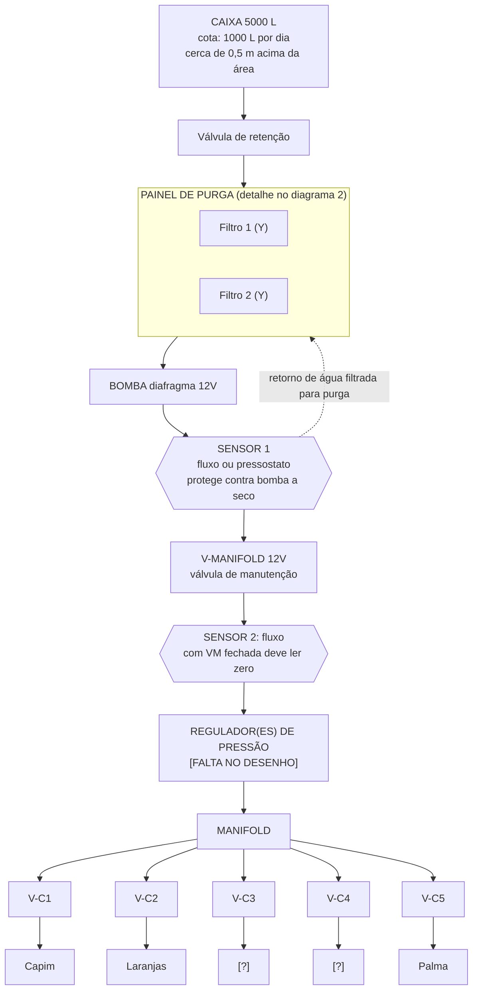
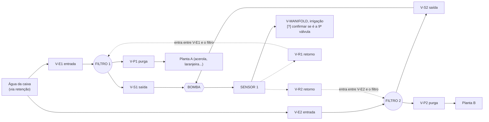
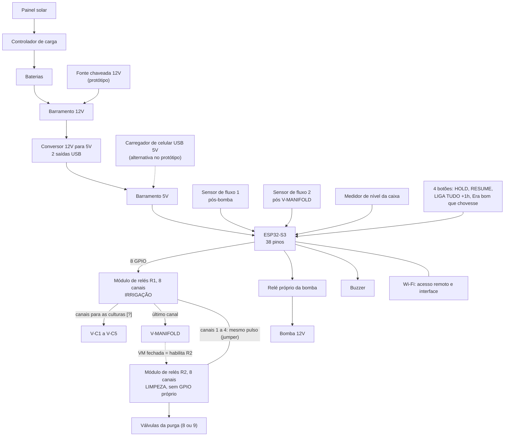

# Irriga.ai: rascunho v0.1

Leitura do arquivo `Irriga_ai-alpha` (PNG e PDF). Tudo marcado com **[?]** é suposição minha e precisa de confirmação antes de virar código.

Contexto: caixa de 5000 L, cota de 1000 L por dia, plantação cerca de 0,5 m abaixo da caixa (alimentação por gravidade), gotejamento mais aspersores pontuais, tudo em 12 V, controle por ESP32-S3.

---

## 1. Hidráulico (visão geral)

---

## 2. Painel de purga (detalhe)

Leitura do lado direito do desenho: linha vermelha é água suja (antes do filtro), linha verde é água filtrada. São 8 válvulas, 4 por filtro, mais a saída da bomba.

### Modos das válvulas (hipótese, A = aberta, F = fechada)

| Modo | E1 | S1 | P1 | R1 | E2 | S2 | P2 | R2 | Saída p/ manifold |
|---|---|---|---|---|---|---|---|---|---|
| Irrigação | A | A | F | F | A | A | F | F | A |
| Purga do filtro 1 | F | F | A | A | A | A | F | F | F |
| Purga do filtro 2 | A | A | F | F | F | F | A | A | F |
| 4º modo | [?] | [?] | [?] | [?] | [?] | [?] | [?] | [?] | [?] |

Lógica: no filtro em purga, a entrada e a saída fecham. A bomba puxa do outro filtro e devolve água limpa pelo retorno, que atravessa o filtro sujo e sai pela purga.

---

## 3. Elétrico

### Pinos do ESP32-S3 (atenção)

- Mais seguros: GPIO 4 a 7, 15 a 18 e 8 a 14.
- Evitar: 0, 3, 45 e 46 (boot), 19 e 20 (USB), 26 a 32 (flash e PSRAM, inutilizáveis no S3), 43 e 44 (UART0).
- Em módulos com PSRAM octal (N8R8, N16R8), os GPIO 33 a 37 também ficam presos.
- Confirmar no pinout da placa exata antes de fixar o mapa de pinos.
- Os sensores de fluxo Hall mandam pulso em 5 V ou mais, então precisam de divisor de tensão para 3,3 V.

---

## 4. Intertravamentos para o código

1. A bomba só liga se existir pelo menos um caminho aberto para a água sair.
2. Se a bomba está ligada e o Sensor 1 lê zero por mais que a tolerância (alguns segundos), desligar tudo e alarmar (buzzer e remoto).
3. Se V-MANIFOLD está fechada e o Sensor 2 lê fluxo, a válvula falhou: desligar a bomba e alarmar.
4. Purga só com V-MANIFOLD fechada. Irrigação só com V-MANIFOLD aberta e todas as válvulas P e R fechadas.
5. Nível baixo na caixa bloqueia a bomba.
6. Dar um timeout em cada purga e em cada irrigação.
7. Comparar a vazão medida com a esperada de cada modo, para detectar entupimento ou vazamento.

---

## 5. Lista de peças (preços do desenho)

| Item | Qtd | Preço |
|---|---|---|
| ESP32-S3, 38 pinos (protoboard) | 1 | R$ 160 |
| Conjunto de relés R1 (8 canais) | 2 [?] | R$ 80 cada |
| Bomba de diafragma 12 V | 1 | R$ 150 |
| Filtro de água de alta vazão | 2 | R$ 300 cada |
| Válvula atuadora (solenoide) 12 V | 14 a 16 [?] | R$ 47 cada |
| Botões (HOLD, RESUME, LIGA TUDO +1h, Era bom que chovesse) | 4 | R$ 15 cada |
| Fonte do protótipo (12 V mais conversor 5 V) | 1 | R$ 38 |
| Sistema solar completo (painel, controlador, baterias) | 1 | R$ 626 |
| Sensor de fluxo Hall | 2 | sem preço no desenho |
| Medidor de nível, buzzer, regulador(es) de pressão, filtro fino pós-bomba | [?] | sem preço no desenho |

---

## 6. Pontos de risco que vi no desenho

1. **Falta regulador de pressão.** Era o problema original. Bomba de diafragma 12 V costuma passar de 100 PSI, e gotejamento aguenta cerca de 1 bar. Precisa de regulador por ramal (gotejamento em cerca de 1 bar, aspersor mais alto), e de alívio ou pressostato para a bomba não forçar com tudo fechado.
2. **Pouca coluna d'água (0,5 m).** Retenção de mola e solenoides comuns podem não abrir. Usar retenção de portinhola (baixa pressão de abertura) e solenoides de ação direta que operem em 0 bar, principalmente no lado da sucção.
3. **Vazão da purga.** Bombas de diafragma 12 V desse porte costumam dar poucos litros por minuto [conferir o modelo], e a purga depende dessa vazão para arrastar a sujeira. Precisa de teste em bancada.
4. **Jumper R1 para R2.** Conferir com que tensão o contato do relé R1 aciona a entrada do R2. Entradas de módulo de relé costumam esperar sinal lógico, e 12 V direto pode danificar.
5. **Corrente em 12 V.** Dimensionar fonte, fusíveis e fiação para a bomba mais 4 ou 5 solenoides ligadas ao mesmo tempo, e conferir se o sistema solar de R$ 626 sustenta.
6. **Destinos.** O desenho mostra 5 válvulas de cultura e só 3 destinos nomeados (Capim, Laranjas, Palma).

---

## 7. Perguntas abertas

1. As tabelas de triângulos: verde é estado nominal e vermelho é acionado? As linhas "1" e "2" são os modos de purga do filtro 1 e do filtro 2? Quais são os 4 modos?
2. As solenoides são normalmente fechadas (NF) ou normalmente abertas (NA)?
3. A válvula à direita da bomba (R$ 47) e a "V-1 (R$ 47)" do desenho 1 são a V-MANIFOLD e a purga, ou são válvulas extras?
4. O filtro é de tela (Y) ou de disco?
5. Marca e modelo da bomba, das solenoides, dos filtros e dos sensores, para a análise de viabilidade.
6. Quais culturas irão em cada válvula (feijão, macaxeira, jerimum, ou capim, laranjas, palma)?
