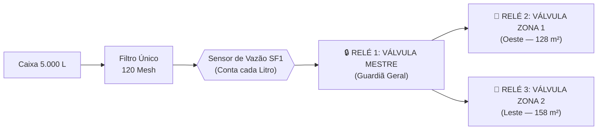
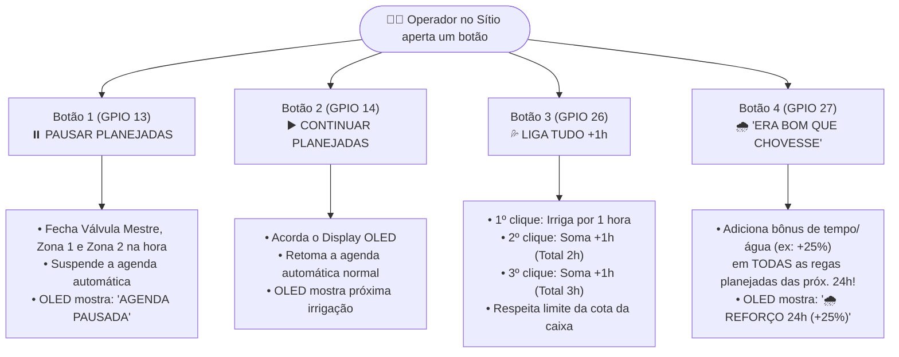
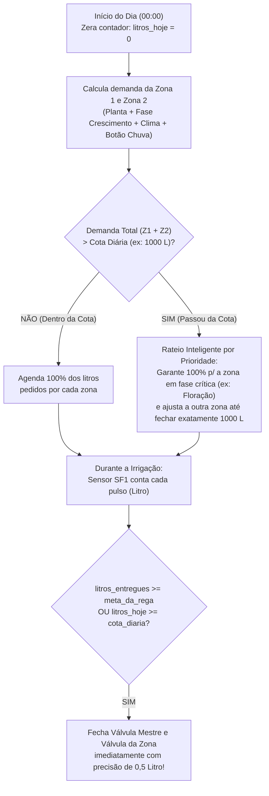

# 01 — Operação do Sistema, Os 4 Botões Físicos e Gestão de Cotas por Vazão

Este documento detalha o funcionamento operacional do **Irriga.ai Pro-Duo**, incluindo a coordenação das **3 válvulas iniciais** (`Válvula Mestre`, `Zona 1` e `Zona 2`), a reserva arquitetural dos outros **5 canais de relé**, a mecânica dos **4 botões físicos de interação humana** (com destaque para o botão lúdico **"Era bom que chovesse"**) e o controle rígido de **cotas de água via sensor de vazão**.

---

## 1. Coordenação das 3 Válvulas Iniciais + Arquitetura de 8 Canais

No **Irriga.ai Pro-Duo**, utilizamos uma **Placa de 8 Relés**, onde **3 canais entram em operação imediata no MVP** e **5 canais já nascem mapeados no código, no banco de dados e no arquivo de plano de irrigação** para futuras expansões.

### 1.1. Por que usar `Válvula Mestre` + `Zona 1` + `Zona 2`? (Segurança Dupla)

Ter uma **Válvula Mestre (`Relé 1`)** em série antes das válvulas das zonas (`Relé 2` e `Relé 3`) resolve o maior risco de sistemas de irrigação rurais:
1. **Dupla Vedação Contra Esvaziamento da Caixa:** Se um pequeno grão ou cisco passar e impedir que a borracha da `Válvula Zona 1` feche 100% ao final da rega, a **Válvula Mestre fecha logo atrás dela**, estancando a linha principal e impedindo que a caixa de $5.000\text{ L}$ vaze inteira durante a madrugada.
2. **Detecção Imediata de Vazamento pelo Sensor `SF1`:** Como o sensor de vazão fica entre o filtro e a Válvula Mestre, se o sistema estiver em repouso e o sensor registrar qualquer giro, o ESP32 sabe na hora que há vazamento e avisa no celular e no buzzer.
3. **Sequência Suave de Acionamento:**
   * **Para abrir uma irrigação:** Abre primeiro a válvula da zona (`Relé 2` ou `Relé 3`), aguarda $500\text{ ms}$ e abre a `Válvula Mestre` (`Relé 1`). *(Isso divide o pico inicial de corrente na fonte 12V!).*
   * **Para encerrar uma irrigação:** Fecha primeiro a `Válvula Mestre` (`Relé 1`), aguarda $1\text{ segundo}$ e fecha a válvula da zona (`Relé 2` ou `Relé 3`).

---

### 1.2. Mapa Completo dos 8 Canais da Placa de Relés (Ativos + Contabilizados para Expansão)

Desde a primeira linha de código do firmware e da interface web, todos os **8 canais** possuem identidade própria (`channel_id` de `1` a `8`) e tipos de comportamento pré-programados (`MASTER_VALVE`, `IRRIGATION_ZONE`, `BOOSTER_PUMP`, `LIGHTING`, `CAMERA_POWER`, `CUSTOM_ACTUATOR`):

| Canal Relé | Pino ESP32 | Status Inicial (MVP) | Identificador no Sistema | Função Atual / Função Futura Já Contabilizada no Código |
| :---: | :---: | :---: | :--- | :--- |
| **Relé 1** | `GPIO 4` | 🟢 **ATIVO NO MVP** | `V_MASTER` | **Válvula Mestre Geral 12V** — Abre sempre que qualquer zona de irrigação estiver ativa; fecha em repouso ou emergência. |
| **Relé 2** | `GPIO 16` | 🟢 **ATIVO NO MVP** | `V_ZONA_1` | **Válvula Zona 1 (Oeste — $128\text{ m}^2$)** — Controlada pela curva da planta da Zona 1. |
| **Relé 3** | `GPIO 17` | 🟢 **ATIVO NO MVP** | `V_ZONA_2` | **Válvula Zona 2 (Leste — $158\text{ m}^2$)** — Controlada pela curva da planta da Zona 2. |
| **Relé 4** | `GPIO 18` | 🟡 *Pré-mapeado* | `EXP_ZONA_3` | **Reserva p/ Válvula Zona 3** (ex.: futura área de Capim ou Fruteiras). Basta habilitar `enabled: true` no arquivo de plano! |
| **Relé 5** | `GPIO 19` | 🟡 *Pré-mapeado* | `EXP_ZONA_4` | **Reserva p/ Válvula Zona 4** (ex.: futura área de Palma ou Horta). |
| **Relé 6** | `GPIO 23` | 🟡 *Pré-mapeado* | `EXP_BOMBA_12V` | **Reserva p/ Bomba Auxiliar 12V** — Código já possui a lógica: se `has_pump: true`, aciona `Relé 6` $2\text{ s}$ após abrir a válvula e desliga $2\text{ s}$ antes de fechar. |
| **Relé 7** | `GPIO 25` | 🟡 *Pré-mapeado* | `EXP_LUZ_PAINEL` | **Reserva p/ Iluminação / Refletor 12V** — Permite ligar refletor LED na área das plantas/caixa pelo app, por horário noturno ou ao apertar botão à noite. |
| **Relé 8** | `GPIO 5` | 🟡 *Pré-mapeado* | `EXP_CAMERA_AUX` | **Reserva p/ Câmera / Sensor / Sirene** — Permite ligar/reiniciar alimentação 12V de câmera Wi-Fi rural (economia de bateria solar) ou sirene de alerta. |

---

## 2. Os 4 Botões Físicos de Interação Humana (Painel Local)

O painel físico do **Pro-Duo** foi pensado para ser **humano, intuitivo e acolhedor** para quem está trabalhando na terra com as mãos ocupadas. Qualquer toque acende o Display OLED `0.96"` e dá um retorno sonoro claro no Buzzer (`GPIO 2`).

### Detalhamento Comportamental de Cada Botão:

#### 1️⃣ Botão "Pausar Irrigações Planejadas" (`GPIO 13`)
* **Cenário de uso:** O caseiro vai entrar na Zona 1 para colher maxixe sem pisar na lama, vai aplicar adubo foliar, consertar uma chula ou quer parar uma rega imediatamente.
* **Comportamento:** Fecha na hora a `Válvula Mestre`, `Zona 1` e `Zona 2`. Coloca o sistema em modo **`PAUSADO`**. Nenhuma irrigação agendada será disparada enquanto o sistema estiver pausado (por segurança, se esquecerem pausado, o aplicativo avisa no celular após 12 horas: *"Lembrete: A irrigação do sítio continua pausada pelo botão físico"*).

#### 2️⃣ Botão "Continuar Irrigações Planejadas" (`GPIO 14`)
* **Cenário de uso:** Terminou o serviço na roça e quer devolver o controle para o piloto automático (ou quer apenas olhar na telinha OLED como está o nível da caixa e a que horas será a próxima rega).
* **Comportamento:**
  * Se o sistema estava **`PAUSADO`**, volta imediatamente para **`AUTOMÁTICO ATIVO`** (emitindo 2 bipes alegres) e, se havia uma irrigação programada para aquele exato horário que foi interrompida há poucos minutos, pergunta/retoma o restante.
  * Se o sistema já estava em **`AUTOMÁTICO`**, apenas acende o Display OLED por $60\text{ segundos}$ e alterna entre as páginas de informações (Nível da Caixa, Cota Usada Hoje, Status da Zona 1 e da Zona 2).

#### 3️⃣ Botão "Liga Tudo por 1 Hora" (`GPIO 26` — Incrementável $+1\text{h}$)
* **Cenário de uso:** Plantio recém-feito de mudas/ramas de batata-doce que precisam de um "banho" imediato, ou teste rápido de campo.
* **Comportamento:**
  * **1º Aperto:** Inicia imediatamente $60\text{ minutos}$ de irrigação ($1\text{ bipe}$).
  * **Cada Aperto Adicional:** Incrementa **$+1\text{ hora}$** no cronômetro regressivo ($2\text{ horas}$, $3\text{ horas}$, até o teto de segurança configurável de $4\text{ horas}$), confirmando no display OLED: **`IRRIGANDO TUDO: Restam 02:00:00`**.
  * **Divisão Inteligente de Pressão:** No arquivo de configuração, você pode escolher se o *"Liga Tudo"* abre `Zona 1 + Zona 2` **simultaneamente** (se houver boa vazão) ou se **alterna automaticamente a cada 30 minutos** ($30\text{ min}$ Zona 1 $\leftrightarrow 30\text{ min}$ Zona 2) para manter a pressão máxima nos gotejadores!

#### 4️⃣ Botão Lúdico *"Era bom que chovesse"* 🌧️ (`GPIO 27`)
* **A Ideia Humana:** Nem tudo na agricultura cabe só nos números frios da estação meteorológica. Às vezes o produtor ou o caseiro caminha entre os pés de melancia ou maxixe, sente o bafo quente da terra e pensa: *"Rapaz, hoje era bom que chovesse..."*. Em vez de precisar abrir configurações complexas no celular e mudar porcentagens, basta apertar esse botão lúdico!
* **O que ele faz no sistema:**
  1. Ao ser pressionado, o Buzzer emite um som suave de confirmação e o Display OLED exibe um ícone de nuvem com chuva: **`🌧️ ERA BOM QUE CHOVESSE! +25% Água (24h)`**.
  2. O sistema ativa um **Multiplicador de Generosidade Hídrica temporário (`boost_24h = +25%`)** válido pelas próximas **24 horas** (todas as regas planejadas da tarde de hoje e da manhã de amanhã terão **25% a mais de tempo e de litros**!).
  3. **Efeito cumulativo controlado:**
     * **1 clique:** $+25\%$ de tempo em todas as irrigações das próximas 24h (Modo *"Chuvinha Boa"*).
     * **2 cliques seguidos:** $+50\%$ de tempo em todas as irrigações das próximas 24h (Modo *"Toró Abençoado"* — limite máximo para não lavar o adubo do solo).
     * **3º clique (ou segurar por 3s):** Desativa o bônus e volta para $+0\%$ (normal).
  4. **Visibilidade no Celular:** Na interface mobile aparece um banner azul simpático com contagem regressiva: *"🌧️ Modo 'Era bom que chovesse' ativo (+25% nas próximas 18h). As plantas agradecem!"*.

---

## 3. Sensor de Vazão (`SF1`) e o Controle Rígido de Cotas de Água

Para proteger a reserva da caixa d'água de $5.000\text{ L}$, o **Irriga.ai Pro-Duo** utiliza um **Sensor de Vazão de Efeito Hall (`SF1` no `GPIO 34`)** instalado na linha tronco antes da `Válvula Mestre`.

### 3.1. Como funciona o Guardião de Cota (`Quota Enforcer`)
O usuário define no aplicativo (ou no arquivo padronizado `plano_irrigacao.yaml`) até três limites de proteção:
1. **Cota Diária Máxima (`cota_diaria_litros`):** ex. `1000` Litros/dia.
2. **Reserva Intocável da Caixa (`nivel_minimo_caixa_pct`):** ex. `25%` ($1.250\text{ L}$ — nunca irriga abaixo desse nível).
3. **Teto Extra para o Botão *"Era bom que chovesse"* (`margem_extra_cota_pct`):** ex. permite usar até $+15\%$ da cota diária se o botão *"Era bom que chovesse"* for acionado e a caixa estiver com nível $\ge 50\%$.

### 3.2. Monitoramento do Filtro Único 120 Mesh pelo Mesmo Sensor
Como o **Pro-Duo** usa **um único filtro de disco de 120 Mesh** (limpeza manual), o próprio sensor de vazão `SF1` faz o papel de "dedo-duro" de sujeira no filtro:
* Quando o filtro está limpo, o sistema grava a vazão normal de cada zona (ex.: `Zona 1 = 10,5 L/min`, `Zona 2 = 12,8 L/min`).
* Se durante uma rega a vazão cair para menos de **$80\%$ do normal** (ex.: caiu de $10,5\text{ L/min}$ para $7,5\text{ L/min}$), o sistema:
  1. **Não deixa a planta com sede:** Como ele conta **Litros reais** pelo sensor (e não apenas minutos cegos de relógio), ele mantém a válvula aberta alguns minutos a mais até completar os litros exatos daquela rega!
  2. **Avisa de forma humana no celular e no OLED:** *"⚠️ A água está passando mais devagar que o normal (71%). Quando puder, dê uma lavada rápida nos discos do filtro 120 Mesh!"*
