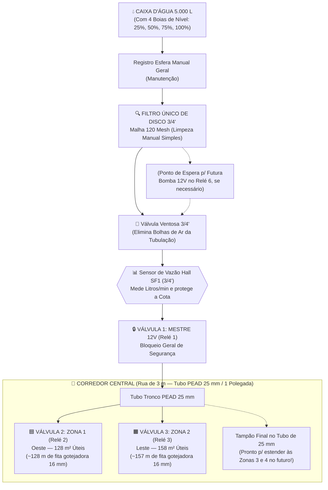

# 02 — Hidráulica Simplificada (Filtro Único 120 Mesh) e Elétrica com Matriz de Expansão

Este documento detalha a montagem física (hidráulica e elétrica) do **Irriga.ai Pro-Duo**. A filosofia aqui é **máxima limpeza construtiva**: usar exatamente **1 filtro de disco 120 Mesh**, **1 sensor de vazão** e **as 3 válvulas solenoides 12V já orçadas no carrinho** (`Válvula Mestre`, `Zona 1` e `Zona 2`), deixando na placa de 8 relés e no ESP32 os pontos prontos para conectar futuras bombas, luzes, câmeras e sensores sem mexer na fiação existente.

---

## 1. Esquema Hidráulico do `Pro-Duo` (Filtro Único + 3 Válvulas)

Repare como as **3 válvulas solenoides 12V** que constam no seu carrinho do Mercado Livre (`3 un x R$ 42,90 = R$ 128,70`) se encaixam com perfeição cirúrgica no **Pro-Duo**:
* **Válvula 1 (`Relé 1`):** **Válvula Mestre (`V_MASTER`)** logo na saída do cavalete junto à caixa d'água.
* **Válvula 2 (`Relé 2`):** **Válvula da Zona 1 (`V_ZONA_1`)** — controla os $128\text{ m}^2$ do lado Oeste.
* **Válvula 3 (`Relé 3`):** **Válvula da Zona 2 (`V_ZONA_2`)** — controla os $158\text{ m}^2$ do lado Leste.

### Vantagens Práticas dessa Montagem Hidráulica Simplificada:
1. **Zero Complexidade de Manobra:** Não há tubulações cruzadas de retrolavagem. Para limpar o filtro **120 Mesh** (quando o aplicativo avisar que a vazão caiu), o caseiro fecha o registro manual, desenrosca o copo do filtro Baldr 3/4" com a mão em 2 minutos, passa uma água nos discos e rosqueia de volta.
2. **Drenagem Rápida das Linhas de 16 mm:** Cada linha de gotejamento das Zonas 1 e 2 sai do tubo de $25\text{ mm}$ com **chula + registro inicial individual** e termina com **tampão de rosca**, permitindo fechar linhas alternadas (para culturas espaçadas como Melancia a $2,0\text{ m}$) e abrir o final da linha para expurgar barro ou ar.
3. **Pronto para Expansão sem Cortar Cano:** Deixando um **Tê com plugue roscado** próximo ao filtro (para futura bomba) e um tampão no final do tubo de $25\text{ mm}$ na rua central, qualquer expansão futura leva menos de 15 minutos.

---

## 2. Mapeamento Elétrico Oficial do `Pro-Duo` (ESP32-WROOM-32D 38 Pinos V4)

O microcontrolador utilizado é o **ESP32-WROOM-32D 38 Pinos Nova Versão V4 DevKitC**. Abaixo está o mapa completo de todas as portas — separando o que você **vai ligar agora no MVP** do que **já fica reservado e programado no código** para expansões futuras:

### 2.1. Placa de 8 Relés (Cargas 12V DC / 220V AC)
*A placa de 8 relés tem suas bobinas internas alimentadas em $5\text{V}$ pelo pino `JD-VCC` (isolamento óptico), mas os **contatos de saída (bornes com parafuso `COM` e `NA`)** chaveiam a linha de **$+12\text{ V DC}$** da Fonte Colmeia 12V 10A para abrir as válvulas solenoides 12V.*

| Canal da Placa | Pino ESP32 | Estado no MVP `Pro-Duo` | Nome no Arquivo de Plano (`YAML`) | O que ligar nos bornes do Relé |
| :---: | :---: | :---: | :--- | :--- |
| **Relé 1 (`IN1`)** | **`GPIO 4`** | ✅ **USADO AGORA** | `valvula_mestre` | **Válvula Solenoide 12V Mestre** (+ Diodo `1N4007` em paralelo). |
| **Relé 2 (`IN2`)** | **`GPIO 16`** | ✅ **USADO AGORA** | `valvula_zona_1` | **Válvula Solenoide 12V Zona 1 (Oeste 128 m²)** (+ Diodo `1N4007`). |
| **Relé 3 (`IN3`)** | **`GPIO 17`** | ✅ **USADO AGORA** | `valvula_zona_2` | **Válvula Solenoide 12V Zona 2 (Leste 158 m²)** (+ Diodo `1N4007`). |
| **Relé 4 (`IN4`)** | **`GPIO 18`** | 🔌 *Contabilizado (Expansão)* | `exp_valvula_zona_3` | Borne livre para futura **Válvula Zona 3** (ex.: Capim / Pomar). |
| **Relé 5 (`IN5`)** | **`GPIO 19`** | 🔌 *Contabilizado (Expansão)* | `exp_valvula_zona_4` | Borne livre para futura **Válvula Zona 4** (ex.: Palma / Horta). |
| **Relé 6 (`IN6`)** | **`GPIO 23`** | 🔌 *Contabilizado (Expansão)* | `exp_bomba_auxiliar` | Borne livre para futura **Bomba 12V** (aciona sincronizada com `V_MASTER`). |
| **Relé 7 (`IN7`)** | **`GPIO 25`** | 🔌 *Contabilizado (Expansão)* | `exp_iluminacao` | Borne livre para **Refletor LED 12V/220V** na área da caixa/plantio. |
| **Relé 8 (`IN8`)** | **`GPIO 5`** | 🔌 *Contabilizado (Expansão)* | `exp_camera_acessorio` | Borne livre para ligar/reiniciar **Câmera Wi-Fi 12V**, espanta-pássaros ou sirene. |

---

### 2.2. Botões Físicos, Sensores e Display Local

| Grupo | Componente | Pino ESP32 | Modo no Código | Status no `Pro-Duo` |
| :--- | :--- | :---: | :---: | :--- |
| **Botões do Usuário** | 1. ⏸️ **Pausar Irrigações Planejadas** | **`GPIO 13`** | `INPUT_PULLUP` | ✅ **USADO AGORA** (Fio p/ `GND`) |
| **Botões do Usuário** | 2. ▶️ **Continuar Irrigações Planejadas** | **`GPIO 14`** | `INPUT_PULLUP` | ✅ **USADO AGORA** (Fio p/ `GND`) |
| **Botões do Usuário** | 3. 💦 **Liga Tudo por 1h (+1h por clique)** | **`GPIO 26`** | `INPUT_PULLUP` | ✅ **USADO AGORA** (Fio p/ `GND`) |
| **Botões do Usuário** | 4. 🌧️ **"Era bom que chovesse" (+Tempo 24h)** | **`GPIO 27`** | `INPUT_PULLUP` | ✅ **USADO AGORA** (Fio p/ `GND`) |
| **Vazão e Cotas** | 📊 **Sensor de Vazão Hall `SF1` (3/4")** | **`GPIO 34`** | `INPUT` (Pulso) | ✅ **USADO AGORA** (Com divisor $5\text{V}\to 3,3\text{V}$) |
| **Nível da Caixa** | 🪣 **Boia Nível 1 (25% — Reserva Mínima)** | **`GPIO 32`** | `INPUT_PULLUP` | ✅ **USADO AGORA** (Fio p/ `GND`) |
| **Nível da Caixa** | 🪣 **Boia Nível 2 (50% — Meia Caixa)** | **`GPIO 33`** | `INPUT_PULLUP` | ✅ **USADO AGORA** (Fio p/ `GND`) |
| **Nível da Caixa** | 🪣 **Boia Nível 3 (75% — Caixa Boa)** | **`GPIO 12`** | `INPUT_PULLUP` | ✅ **USADO AGORA** (Fio p/ `GND`) |
| **Nível da Caixa** | 🪣 **Boia Nível 4 (100% — Caixa Cheia)** | **`GPIO 15`** | `INPUT_PULLUP` | ✅ **USADO AGORA** (Fio p/ `GND`) |
| **Visor e Som** | 🖥️ **Display OLED 0.96" I2C (`SDA` / `SCL`)** | **`GPIO 21 / 22`** | `I2C` | ✅ **USADO AGORA** |
| **Visor e Som** | 🔔 **Buzzer Ativo 3.3V/5V** | **`GPIO 2`** | `OUTPUT` | ✅ **USADO AGORA** |
| **Sensores Futuros** | 🌡️ **Entrada p/ Sensor de Temperatura/Solo 1** | **`GPIO 35`** | `ADC1 / INPUT` | 🔌 *Contabilizado (Expansão)* |
| **Sensores Futuros** | 🌱 **Entrada p/ Sensor de Umidade de Solo 2** | **`GPIO 36 (VP)`** | `ADC1_CH0` | 🔌 *Contabilizado (Expansão)* |
| **Sensores Futuros** | ☀️ **Entrada p/ Tensão Bateria Solar / Chuva** | **`GPIO 39 (VN)`** | `ADC1_CH3` | 🔌 *Contabilizado (Expansão)* |

> [!CAUTION]
> **Lembrete de Ouro na Montagem:**
> 1. Nos pinos dos **4 Botões** e das **4 Boias** (que encostam no `GND` quando acionados), o código usa exclusivamente `INPUT_PULLUP` — **nunca** configure-os como `OUTPUT HIGH` para evitar curto-circuito no pino.
> 2. Coloque um **diodo `1N4007`** nos fios de cada uma das **3 válvulas solenoides 12V** (faixa prateada no positivo $+12\text{V}$, lado preto no negativo) e **retire o jumper `JD-VCC`** da placa de relés para que o desligamento das válvulas nunca gere interferência na telinha OLED.

---

## 3. Lista de Materiais (BOM) Enxuta do `Irriga.ai Pro-Duo`

Como o **Pro-Duo** dispensa o segundo filtro de retrolavagem, a segunda placa de relés e as dezenas de válvulas extras, o custo de materialização é altamente enxuto — aproveitando **100% dos itens que você já colocou no carrinho do Mercado Livre**:

| Grupo | Item | Qtd | Custo (R$) | Observação |
| :--- | :--- | :-: | :---: | :--- |
| **1. Kit Carrinho ML (Base Completa)** | Todos os 19 itens do **Cenário 3 ("Sem Excessos")** *(ESP32 38p V4, 1x Módulo 8 Relés, Fonte 12V 10A, Conversor 12V->5V USB, Caixa IP54, **3x Solenoides 3/4" 12V**, **1x Filtro Disco 120 Mesh**, 1x Ventosa 3/4", Rolo 300m Fita Gotejo 16mm, 50 Registros+Chulas, 50 Tampões, Broca 16mm, Protoboard, Jumpers, Botões PBS-110, Kit Solda)* | 1 pacote | **R$ 1.236,62** | *Se incluir o rolo de 50m de Cabo PP e o rolo de 200m de Tubo PEAD 25mm (Cenário 4), fica **R$ 1.762,16** (ou ~R$ 1.560 comprando apenas 50m de tubo PEAD).* |
| **2. Sensores de Cota e Interface Local** | • **1x Sensor de Vazão Hall 3/4" (YF-S201)** ($\text{R\$ } 38,00$) • **4x Boias Magnéticas de Nível PP** ($\text{R\$ } 64,00$) • **1x Display OLED 0.96" I2C + 1x Buzzer Ativo** ($\text{R\$ } 30,50$) • **Kit Diodos `1N4007` + Resistores $10\text{ k}\Omega$ + Conexões PVC 3/4"** ($\text{R\$ } 71,00$) | 1 kit | **R$ 203,50** | Essenciais para medir a cota em litros reais e exibir os dados no painel. |
| **TOTAL DO SISTEMA `PRO-DUO`** | **Hardware Completo para as 2 Zonas + 5 Slots de Expansão Prontos** | | **R$ 1.440,12** *(sem PEAD/Cabo)* **R$ 1.965,66** *(com 200m PEAD + 50m Cabo PP)* | **Custo mensal de software e nuvem: R$ 0,00/mês.** |
