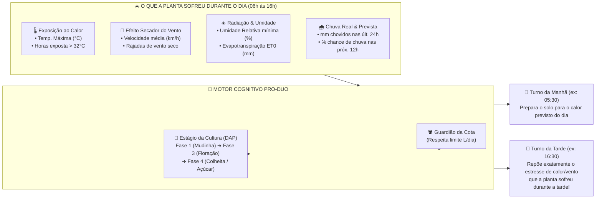

# 03 — Inteligência Climática, Exposição Diurna (Calor e Vento) e Fenologia das 2 Zonas

O grande diferencial do **Irriga.ai Pro-Duo** está no seu "cérebro agronômico": embora o hardware seja enxuto e focado em **duas zonas de plantio (`Zona 1` e `Zona 2`)**, o software analisa hora a hora a **biologia de cada planta**, o seu **estágio exato de desenvolvimento** e o **desgaste ambiental real (calor, vento seco, radiação solar e chuva)** a que cada zona foi submetida durante o dia em **São Vicente do Seridó – PB** (`-6.95325, -36.36853`).

---

## 1. Como o `Pro-Duo` Lê o Dia da Planta: Calor, Vento, Radiação e Chuva

Muitos sistemas comuns olham apenas se "vai chover ou não". No semiárido paraibano, porém, dois dias sem chuva podem exigir quantidades de água completamente diferentes: um dia nublado de $28^\circ\text{C}$ sem vento consome metade da água de um dia de céu aberto com **$35^\circ\text{C}$ e vento seco de $28\text{ km/h}$**.

Por isso, o **Irriga.ai Pro-Duo** coleta da API meteorológica (`Open-Meteo` horária e diária para `-6.95325, -36.36853`) **4 dimensões climáticas** para calcular a sede real de cada zona:

### 1.1. Os 4 Índices Ambientais que Ajustam o Tempo de Irrigação

| Fator Ambiental Lido | O que acontece com a planta no campo | Como o `Pro-Duo` reage automaticamente |
| :--- | :--- | :--- |
| **1. Calor Acumulado no Dia** (`temperature_2m` horária) | Quando a folha fica horas seguidas acima de **$32^\circ\text{C}\text{–}34^\circ\text{C}$**, a planta transpira intensamente para não "cozinhar" seus tecidos e pode murchar à tarde. | Conta quantas **horas de calor intenso ($>32^\circ\text{C}$)** a planta enfrentou entre $10\text{h}$ e $16\text{h}$. A cada hora acima de $32^\circ\text{C}$ (além do normal), adiciona um reforço de **$+3\%\text{ a }+5\%$** na rega de recuperação do fim da tarde (`16:30`). |
| **2. Exposição ao Vento** (`wind_speed_10m` e rajadas) | O vento constante do Seridó remove a camada de ar úmido ao redor das folhas (*efeito secador de cabelo*), acelerando a perda de água no solo e nas folhas largas (Melancia, Maxixe, Jerimum). | Quando o vento diurno médio ultrapassa **$20\text{ km/h}$** com umidade baixa ($<40\%$), aplica o **Fator de Proteção Eólica ($+8\%\text{ a }+15\%$)** e prioriza o turno do início da manhã/final da tarde (quando o vento amaina). |
| **3. Evapotranspiração ($ET_0$ FAO-56)** | Combina radiação solar, temperatura, vento e umidade em um único índice científico de perda de água ($\text{mm/dia}$). | Usa o $ET_0$ real do dia multiplicado pelo coeficiente do estágio da planta ($K_c$) para definir a base de litros por $\text{m}^2$. |
| **4. Previsão de Chuva e Chuva Recente** | Irrigar pesado minutos antes de uma chuva forte desperdiça água da caixa e lava o adubo da raiz (lixiviação). | Se choveu ontem, desconta $80\%$ dos $\text{mm}$ chovidos. Se há **$\ge 75\%$ de chance de chuva $\ge 5\text{ mm}$** para as próximas horas, segura/reduz a rega da manhã e reavalia às `15:30`! |

---

## 2. O *Timing* Perfeito das DUAS Zonas (`Zona 1` e `Zona 2`)

Como o **Pro-Duo** é dedicado a **duas zonas**, ele orquestra o *timing* entre elas para extrair a máxima eficiência hidráulica e agronômica:

### 2.1. Escalonamento Sequencial (*Anti-Queda de Pressão*)
Em vez de abrir a `Zona 1` ($128\text{ m}^2$) e a `Zona 2` ($158\text{ m}^2$) ao mesmo tempo — o que dividiria a vazão do filtro único de 120 Mesh pela metade e derrubaria a pressão nas pontas das mangueiras —, o **Pro-Duo** opera em **Cascata Inteligente**:
1. **Turno da Manhã (Preparação para o Sol):**
   * `05:30 às 06:05` $\to$ Abre `Válvula Mestre` + `Válvula Zona 1` (100% da pressão dedicada à Zona 1).
   * `06:05 às 06:50` $\to$ Mantém `Válvula Mestre` aberta, fecha `Zona 1` e abre `Zona 2` (100% da pressão dedicada à Zona 2).
   * `06:50` $\to$ Fecha `Válvula Mestre` e `Zona 2`. Toda a irrigação matinal termina antes das $07\text{h}$ da manhã, quando a água no cano ainda está fresca e a evaporação é mínima!
2. **Turno do Fim da Tarde (Recuperação do Estresse Térmico):**
   * `16:30 às 16:55` $\to$ Irriga a `Zona 1` repondo o desgaste térmico do dia.
   * `16:55 às 17:25` $\to$ Irriga a `Zona 2` deixando o bulbo radicular úmido para o crescimento noturno dos frutos/raízes.

---

## 3. Controle Personalizado por Planta e Estágio de Crescimento (DAP)

Cada cultura plantada na `Zona 1` ou na `Zona 2` passa por **5 estágios biológicos** ao longo da sua vida (contados automaticamente em **DAP = Dias Após o Plantio**).

Veja na tabela abaixo como o **Pro-Duo** muda sozinho o comportamento da irrigação conforme a planta cresce (baseado no [`guia_culturas_gotejamento.pdf`](file:///c:/irriga-ai/legacy/ContextIngested/guia_culturas_gotejamento.pdf)):

| Cultura | 🌱 **1. Bebê / Pegamento** *(Raiz curta: regas curtas e frequentes)* | 🌿 **2. Crescimento / Ramas** *(Aumenta volume gradualmente)* | 🌸 **3. Floração e Frutificação / Raiz** *(FASE CRÍTICA: Proibido faltar água!)* | 🧺 **4. Colheita / Enchimento** *(Mantém produção)* | 🍯 **5. Reta Final Pré-Colheita** *(Ajuste fino de qualidade/açúcar)* |
| :--- | :--- | :--- | :--- | :--- | :--- |
| **🍉 Melancia** *(Ciclo ~88 dias)* | **Dias 1 a 18** $45\%$ da lâmina *(~2,2 mm/dia)* | **Dias 19 a 42** $75\%$ da lâmina *(~3,8 mm/dia)* | **Dias 43 a 68** 🚨 **$105\%$ da lâmina** *(~5,5 mm/dia — Prioridade Total!)* | **Dias 69 a 78** $75\%$ da lâmina *(~3,8 mm/dia)* | **Dias 79 a 88 (Últimos 10d)** **Reduz para $35\%$ (~1,5 mm/dia)!** *Concentra o açúcar na polpa e evita que a melancia rache!* |
| **🥒 Maxixe** *(Ciclo ~100 dias)* | **Dias 1 a 20** $50\%$ da lâmina *(~2,5 mm/dia)* | **Dias 21 a 42** $80\%$ da lâmina *(~3,8 mm/dia)* | **Dias 43 a 60** 🚨 **$100\%$ da lâmina** *(~4,8 mm/dia — Início dos frutos)* | **Dias 61 a 90** $90\%$ da lâmina *(Colheita a cada 2–3 dias)* | **Dias 91 a 100** $65\%$ da lâmina *(Final de safra)* |
| **🍠 Batata-doce** *(Ciclo ~130 dias)* | **Dias 1 a 20** $50\%$ da lâmina *(Pegamento das ramas)* | **Dias 21 a 30** $75\%$ da lâmina *(~3,5 mm/dia)* | **Dias 31 a 75** 🚨 **$110\%$ da lâmina** *(~5,0 mm/dia — Formação das raízes)* | **Dias 76 a 115** $75\%$ da lâmina *(Engorda das batatas)* | **Dias 116 a 130 (Últimos 15d)** **Reduz para $30\%$ (~1,2 mm/dia)!** *Seca a terra p/ colher limpa e curar melhor!* |
| **🫛 Feijão Verde** *(Ciclo ~68 dias)* | **Dias 1 a 15** $45\%$ da lâmina *(~2,2 mm/dia)* | **Dias 16 a 32** $75\%$ da lâmina *(~3,8 mm/dia)* | **Dias 33 a 55** 🚨 **$110\%$ da lâmina** *(~5,4 mm/dia — Flor e enchimento de vagem)* | **Dias 56 a 68** $80\%$ da lâmina *(Apanha escalonada)* | *(Colhido verde e tenro; mantém rega leve até a última apanha)* |
| **🎃 Jerimum** *(Ciclo ~110 dias)* | **Dias 1 a 22** $45\%$ da lâmina | **Dias 23 a 50** $75\%$ da lâmina | **Dias 51 a 85** 🚨 **$100\%$ da lâmina** *(Floração e enchimento)* | **Dias 86 a 98** $70\%$ da lâmina | **Dias 99 a 110 (Últimos 12d)** **Reduz para $35\%$!** *Fruto fica enxuto e dura semanas guardado.* |
| **🌽 Milho Verde** *(Ciclo ~82 dias)* | **Dias 1 a 18** $45\%$ da lâmina | **Dias 19 a 42** $85\%$ da lâmina | **Dias 43 a 68** 🚨 **$120\%$ da lâmina** *(Pendoamento e boneca — sede máxima!)* | **Dias 69 a 82** $95\%$ da lâmina *(Grão leitoso p/ pamonha/espiga)* | *(Colhido verde com espiga cheia)* |
| **🪵 Macaxeira** *(Ciclo ~300 dias)* | **Dias 1 a 90** 🚨 **$65\%$ a $80\%$** *(3 primeiros meses são críticos!)* | **Dias 91 a 180** $80\%$ da lâmina | **Dias 181 a 240** $60\%$ da lâmina | **Dias 241 a 285** $40\%$ da lâmina | **Dias 286 a 300** $25\%$ da lâmina |

---

## 4. Exemplo Real de Decisão Cognitiva nas Duas Zonas

Imagine uma quinta-feira de novembro em **São Vicente do Seridó – PB**:
* **Na Zona 1 ($128\text{ m}^2$):** Está plantado **Feijão Verde** no **Dia 42** (*Fase 3 Crítica: Floração e enchimento de vagens*).
* **Na Zona 2 ($158\text{ m}^2$):** Está plantada **Melancia** no **Dia 82** (*Fase 5: Faltam 6 dias para colher — fase de apurar o açúcar*).
* **O que aconteceu no clima do dia:** Não choveu, a temperatura bateu **$35,4^\circ\text{C}$** por 4 horas à tarde e o vento soprou a **$26\text{ km/h}$**.
* **O que o `Irriga.ai Pro-Duo` faz sozinho (e explica para você no celular):**
  1. Na **Zona 2 (Melancia no Dia 82)**: Apesar do calor, o sistema **mantém a rega reduzida ($1,6\text{ mm} = 252\text{ Litros}$)** porque a melancia está na semana final de concentração de açúcar, aplicando apenas um pulso curto à tarde para a rama não queimar de sol sem inchar o fruto.
  2. Na **Zona 1 (Feijão Verde em Floração no Dia 42)**: Como a flor do feijão aborta se passar sede no calor e vento forte, o sistema usa a água economizada pela melancia para dar um **reforço extra de $+18\%$ na Zona 1 ($6,1\text{ mm} = 780\text{ Litros}$)**!
  3. **Consumo Total do Dia:** $252\text{ L} + 780\text{ L} = \mathbf{1.032\text{ Litros}}$ (cravado dentro da cota da caixa, salvando a florada do feijão e deixando a melancia docinha!).
