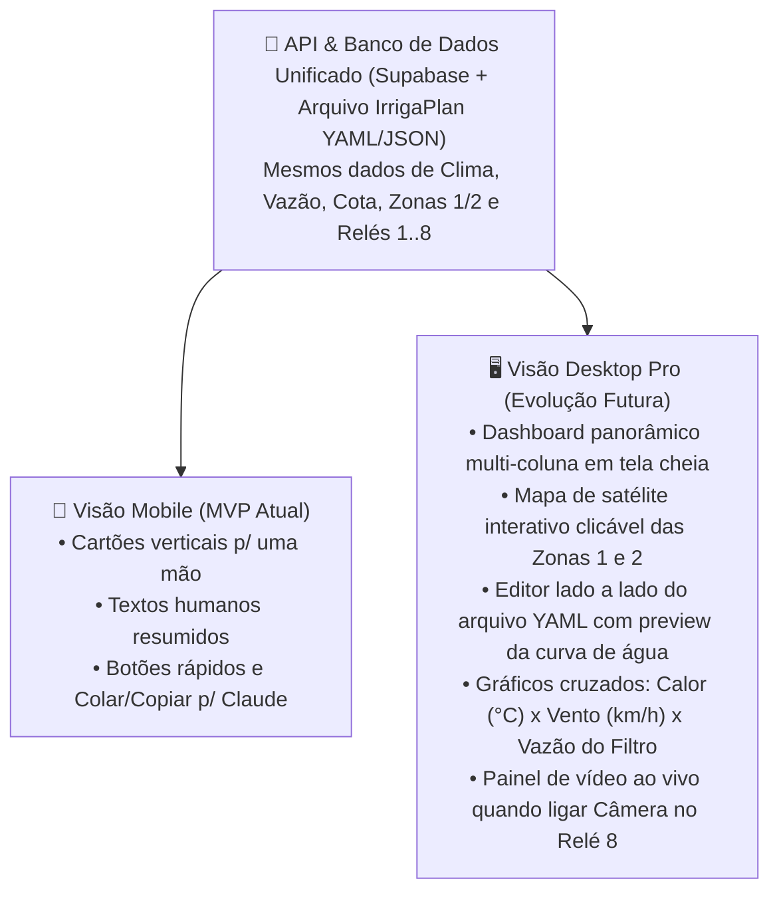

# 04 — Interface Digital Humana (Mobile-First) e Abertura para Desktop Futuro

Este documento especifica o design de experiência do usuário (UX/UI) e a arquitetura de frontend do **Irriga.ai Pro-Duo**. O objetivo central é entregar um sistema **completo por dentro, mas extremamente humano, empático e fácil de mexer por fora** — desenhado primeiro para a tela do **celular** (uso rápido no campo ou na cidade), mas com fundação técnica pronta para expandir em uma **estação de comando Desktop** no futuro.

---

## 1. Filosofia de UX: "Inteligência de Engenheiro, Conversa de Amigo"

Sistemas agrícolas tradicionais falham porque parecem painéis de avião cheios de siglas (`ET0`, `Kc`, `VPD`, `m.c.a.`, `GPIO`). No **Irriga.ai Pro-Duo**, o motor matemático roda nos bastidores e a tela fala a língua do produtor:

| Em vez de mostrar apenas isto (Frio/Técnico)... | O `Irriga.ai Pro-Duo` mostra isto (Humano e Claro) + Detalhe técnico se tocar para expandir: |
| :--- | :--- |
| `Zone 2: Kc=0.35, DAP=80, Target=280L` | 🍉 **Zona 2 — Melancia (Reta Final: Dia 80 de 88)**<br>*"Faltam ~8 dias para a colheita! Diminuímos a rega em 65% (280 L hoje) para concentrar o açúcar na fruta."* |
| `Temp_Max=35.2C, Wind=26km/h, ET0=5.8mm` | 🔥 **O dia hoje foi puxado para as plantas!**<br>*"Elas enfrentaram 4 horas de sol acima de 33°C e vento seco de 26 km/h. Adicionamos +15% de água fresca na rega das 16h30."* |
| `Flow_Rate=7.1 L/min (68% of Q_ref)` | 🧹 **Hora de dar um trato no filtro 120 Mesh**<br>*"A água está passando um pouco mais devagar (68% da força normal). O sistema compensou o tempo sozinho hoje, mas vale lavar o filtro quando puder."* |
| `Override_4 = TRUE (TTL: 19h)` | 🌧️ **"Era bom que chovesse" está ligado!**<br>*"Todas as regas ganharam +25% de água extra pelas próximas 19 horas."* |

---

## 2. Layout *Mobile-First* (Pensado para Usar com Uma Mão no Celular)

A interface de celular funciona como um **Aplicativo Instalável (PWA)** dividido em cartões claros e uma barra inferior fixa para o polegar:

```text
+-------------------------------------------------------+
| 🌱 Irriga.ai Pro-Duo          🟢 Sítio Online  [⚙️]  |
| 📍 São Vicente do Seridó - PB                         |
+-------------------------------------------------------+
| ☀️ COMO FOI O DIA DAS PLANTAS HOJE                    |
| 🌡️ Calor: 34°C (3h30 de sol forte)                    |
| 💨 Vento: 24 km/h (Seco à tarde)   🌧️ Chuva: 5% (0mm) |
| 💬 "Tarde quente e ventosa: rega das 16h30 reforçada" |
+-------------------------------------------------------+
| 🪣 CAIXA D'ÁGUA (5.000 L)        COTA DO DIA          |
| [■■■■■■■░░░] 75% (~3.750 L)      620 L / 1.000 L      |
| 🔍 Filtro 120 Mesh: Limpo (96%)  🔒 Válv. Mestre: OK  |
+-------------------------------------------------------+
| 🟦 ZONA 1 (Oeste • 128 m²)               [Ver / IA]   |
| 🥒 Maxixe • Dia 48 de 100                             |
| 🌸 Fase Atual: Início da Frutificação (Fase Crítica!) |
| 💧 Hoje: 520 L (Manhã: ✅ 310L | 16h30: ⏳ 210L)      |
+-------------------------------------------------------+
| 🟧 ZONA 2 (Leste • 158 m²)               [Ver / IA]   |
| 🍉 Melancia • Dia 81 de 88                            |
| 🍯 Fase Atual: Reta Final — Apurando o Açúcar!        |
| 💧 Hoje: 260 L (Reduzido p/ adoçar a fruta)           |
+-------------------------------------------------------+
| ⚡ AÇÕES RÁPIDAS (Mesmos botões da caixa no sítio!)    |
| [⏸️ Pausar] [▶️ Continuar] [💦 +1h] [🌧️ Era bom chover]|
+-------------------------------------------------------+
|  🏠 Início   |  🌱 Zonas   |  🤖 Plano IA  |  🔌 Extras |
+-------------------------------------------------------+
```

### 2.1. O Que Há em Cada Guia do Celular:

1. **🏠 Início (Visão de 5 Segundos):**
   * Mostra de imediato se está tudo bem, quanto tem de água na caixa, quanto da **cota diária** já foi gasto pelo sensor de vazão, o **resumo do clima/calor/vento a que as plantas foram expostas hoje** e os **4 botões rápidos** (espelhados com os botões físicos do sítio: se o caseiro apertar *"Era bom que chovesse"* lá na roça, o botão acende em azul no seu celular no mesmo segundo!).

2. **🌱 Zonas 1 e 2 (Raio-X da Planta e do Crescimento):**
   * Ao tocar na **Zona 1** ou na **Zona 2**, abre o painel dedicado daquela plantação:
     * **Seletor Fácil de Cultura:** Escolha entre *Maxixe, Melancia, Batata-doce, Feijão Verde, Jerimum, Milho Verde, Macaxeira, Mandioca, Batatinha* (ou cultura personalizada) e a data em que plantou.
     * **Régua Visual das 5 Fases da Planta:** Mostra uma linha do tempo colorida indicando em que fase a planta está hoje, quando começará a colheita e como a quantidade de água vai subir ou descer nas próximas semanas.
     * **Termômetro de Exposição da Zona:** Gráficos simples de *Calor sofrido na semana*, *Vento* e *Litros recebidos por dia*.
     * **Controle Fino Manual (se quiser mexer sem IA):** Um controle deslizante simples (`Mais econômica -30% <---> Normal <---> Mais generosa +30%`) e escolha de quantas mangueiras de 16mm estão abertas na zona.

3. **🤖 Plano IA (Integração Direta com o Claude):**
   * Uma tela pensada especialmente para o seu fluxo com o arquivo padronizado:
     * Botão **`[📋 Copiar Plano Atual + Instruções para o Claude]`**: Copia o arquivo `plano_irrigacao.yaml` do sítio já acompanhado do contexto para você colar no chat do Claude.
     * Campo **`[📥 Colar Plano Gerado pelo Claude]`**: Você cola o texto que o Claude respondeu, o aplicativo mostra um **Resumo das Mudanças em Português Claro** (ex.: *"O Claude alterou a Zona 1 para Feijão Verde, mudou o horário da tarde para 17h00 e definiu a cota em 950 L/dia"*) e um botão **`[✅ Aprovar e Enviar para o Sítio]`**.

4. **🔌 Extras (Slots de Expansão Já Prontos na Interface):**
   * Mostra os **5 canais de relé livres (`Relés 4 a 8`)** e os **3 pinos de sensores extras** como "Cartões de Expansão Adormecidos":
     * `➕ Ativar Zona 3 (Relé 4)`
     * `➕ Ativar Zona 4 (Relé 5)`
     * `➕ Ativar Bomba Auxiliar 12V (Relé 6)`
     * `💡 Ativar Luz / Refletor do Sítio (Relé 7)`
     * `📷 Ativar Câmera / Acessório (Relé 8)`
   * Quando você instalar qualquer um desses itens no futuro, basta tocar em **"Ativar"** no aplicativo (sem precisar reescrever o sistema!).

---

## 3. Abertura Arquitetural para o Futuro Desktop Completo (*Command Center*)

Embora o foco imediato seja o celular (*Mobile-First*), a aplicação web é construída sobre **Next.js + Tailwind CSS com Design System Responsivo e API Desacoplada**. Isso garante que, quando você quiser desenvolver ou abrir a visão de **Desktop Completa** (em um monitor grande ou notebook), toda a base de dados e inteligência já estará pronta:



### Como garantir desde já que o código Mobile facilite o Desktop futuro:
1. **Separação Total entre Lógica/Dados e Componentes Visuais:** Todo o cálculo de fases da planta, exposição ao calor/vento e leitura do arquivo `IrrigaPlan` fica em funções puras compartilhadas (`lib/irriga-engine/`), e não preso dentro de telas pequenas de celular.
2. **Histórico Rico Guardado desde o Dia 1:** Mesmo que no celular mostremos um resumo limpo do dia, o banco de dados já guarda gratuitamente o histórico diário de temperatura máxima, horas de calor, vento, vazão do filtro 120 Mesh e litros por zona — para que, quando você abrir a futura tela de Desktop, já existam meses de gráficos históricos prontos para análise!
