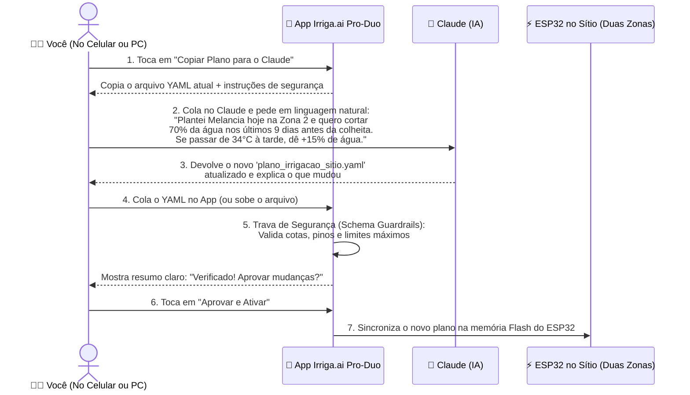

# 05 — Padrão de Arquivo `IrrigaPlan` (YAML/JSON): Gestão de Irrigação Assistida por IA (Claude)

Um dos recursos mais poderosos do **Irriga.ai Pro-Duo** é que **toda a inteligência, regras de cota, reação ao clima, estágios das plantas e canais de relé são comandados por um único arquivo de texto padronizado, autoexplicativo e legível por humanos**: o arquivo **`plano_irrigacao_sitio.yaml`** (Padrão **`IrrigaPlan v1.0`**).

Isso permite que você gerencie o sítio de duas maneiras complementares:
1. **Visualmente pelo Celular:** Tocando nos botões e seletores normais do aplicativo.
2. **Conversando com o Claude (ou outra IA):** Passando o arquivo atual para o Claude e pedindo em português comum qualquer mudança — desde trocar a cultura de uma zona até criar uma regra personalizada para ondas de calor ou ativar um refletor num relé de expansão!

---

## 1. Por que escolhemos o formato `YAML` (com Schema JSON integrado)?

| Critério | Vantagem Prática para Você e para o Claude |
| :--- | :--- |
| **100% Legível por Humanos** | Diferente de códigos de programação ou JSONs cheios de chaves `{}` e aspas `""`, o `YAML` parece uma ficha técnica limpa em português. Qualquer pessoa bate o olho e entende o que cada zona está fazendo. |
| **Aceita Comentários Explicativos (`#`)** | O próprio arquivo carrega comentários que servem como **"manual de instruções embutido"** tanto para você quanto para o Claude saber exatamente quais valores são permitidos em cada campo. |
| **Formato Favorito de LLMs (Claude)** | O Claude lê e edita arquivos `YAML` com altíssima precisão, gastando menos tokens e sem cometer erros de vírgula esquecida (comuns em JSON puro). |
| **Conversão Automática para o ESP32** | Quando você cola o `YAML` gerado pelo Claude no aplicativo, o sistema valida tudo usando o [`irriga_plan.schema.json`](file:///c:/irriga-ai/pro-duo/planos/irriga_plan.schema.json), salva o `YAML` completo para você e envia uma versão binária/JSON enxuta direto para a memória do ESP32 no sítio. |

---

## 2. Como Funciona o Fluxo com o Claude na Prática (Passo a Passo)

---

## 3. O Que Você Pode Pedir para o Claude Fazer no Arquivo?

O padrão **`IrrigaPlan v1.0`** foi desenhado com **flexibilidade híbrida** para que o Claude consiga atender qualquer tipo de pedido seu:

### Caso A: "Claude, monte o plano completo da nova safra para mim"
> **O que você diz ao Claude:** *"Hoje (10/11/2026) plantei Feijão Verde na Zona 1 (todas as 16 mangueiras abertas) e Melancia na Zona 2 (8 mangueiras abertas, espaçamento de 2m). Minha cota máxima da caixa é de 1.000 Litros por dia. Monte o plano completo com todas as fases de crescimento."*
* **O que o Claude faz no arquivo:** Preenche automaticamente as datas de plantio, calcula a área molhada, cria as 5 fases de crescimento (`fases_fenologicas`) do Feijão Verde e da Melancia (já incluindo o corte de água nos últimos 10 dias da melancia para adoçar o fruto) e define as prioridades de cota.

### Caso B: "Claude, faça um ajuste fino para esta semana de calor"
> **O que você diz ao Claude:** *"As mudas de Maxixe da Zona 1 estão sentindo muito o vento da tarde. Pelos próximos 5 dias, adicione um pulso extra rapidinho de 100 Litros às 14h00 na Zona 1 e aumente a sensibilidade ao vento para 15%."*
* **O que o Claude faz no arquivo:** Adiciona um bloco `ajuste_temporario` com data de expiração automática (`valido_ate: "2026-11-15"`) e um 3º turno às `14:00` apenas na Zona 1, sem bagunçar o resto do ciclo!

### Caso C: "Claude, instalei um refletor LED no Relé 7 (ou uma bomba no Relé 6)"
> **O que você diz ao Claude:** *"Liguei um refletor de 12V nos parafusos do Relé 7. Configure o plano para ligar esse refletor todos os dias das 18h00 às 21h30."*
* **O que o Claude faz no arquivo:** Vai na seção `canais_expansao_reles` do mesmo arquivo YAML, muda o `rele_7` para `ativo: true` e adiciona `horarios_ligado: ["18:00-21:30"]`.

---

## 4. As 5 Travas de Segurança (*Guardrails*) Contra Erros de IA

Mesmo que um dia você (ou a IA) digite um número errado por engano no arquivo (como colocar `10.000 Litros` ou trocar o número de um pino do ESP32), o validador do **Irriga.ai Pro-Duo** protege o hardware e as plantas antes de aceitar o arquivo:

1. **Trava de Pinout Imutável:** Os pinos físicos do ESP32 (`GPIO 4, 16, 17...`) são validados contra a tabela oficial de hardware; nenhum arquivo externo consegue transformar um pino de botão/boia (`GND`) em saída `OUTPUT HIGH`.
2. **Trava de Teto de Cota (`hard_max_daily_liters`):** Se a soma dos turnos superar a cota máxima configurada no cadeado de segurança da caixa, o sistema avisa na tela e aplica o teto da cota pelo sensor de vazão `SF1`.
3. **Trava de Tempo Máximo por Válvula:** Nenhum turno individual pode ultrapassar `180 minutos` contínuos sem confirmação explícita.
4. **Trava da Válvula Mestre (`V_MASTER`):** Independentemente do que esteja escrito no arquivo, o firmware do ESP32 garante que o `Relé 1 (Válvula Mestre)` abra e feche sincronizado com as zonas.
5. **Validação de Rotação Botânica:** Se o novo plano colocar duas safras seguidas da mesma família botânica na mesma zona (ex.: *Melancia* logo depois de *Maxixe*, ambas *Cucurbitáceas*), o aplicativo exibe um aviso amigável lembrando do risco de pragas antes de salvar.

---

## 5. Arquivos Oficiais na Pasta [`pro-duo/planos/`](file:///c:/irriga-ai/pro-duo/planos)

Para que você já tenha tudo pronto em mãos, criamos na subpasta [`planos/`](file:///c:/irriga-ai/pro-duo/planos) três arquivos fundamentais:

1. 📄 **[`planos/plano_irrigacao_sitio.yaml`](file:///c:/irriga-ai/pro-duo/planos/plano_irrigacao_sitio.yaml):** O arquivo real de configuração do **Irriga.ai Pro-Duo**, completo e documentado linha a linha.
2. 📐 **[`planos/irriga_plan.schema.json`](file:///c:/irriga-ai/pro-duo/planos/irriga_plan.schema.json):** O contrato técnico (JSON Schema) que valida automaticamente qualquer plano.
3. 💬 **[`planos/PROMPT_PARA_O_CLAUDE.md`](file:///c:/irriga-ai/pro-duo/planos/PROMPT_PARA_O_CLAUDE.md):** O texto de comando pronto para você copiar e colar no Claude sempre que quiser que ele crie ou edite seus planos de irrigação.
