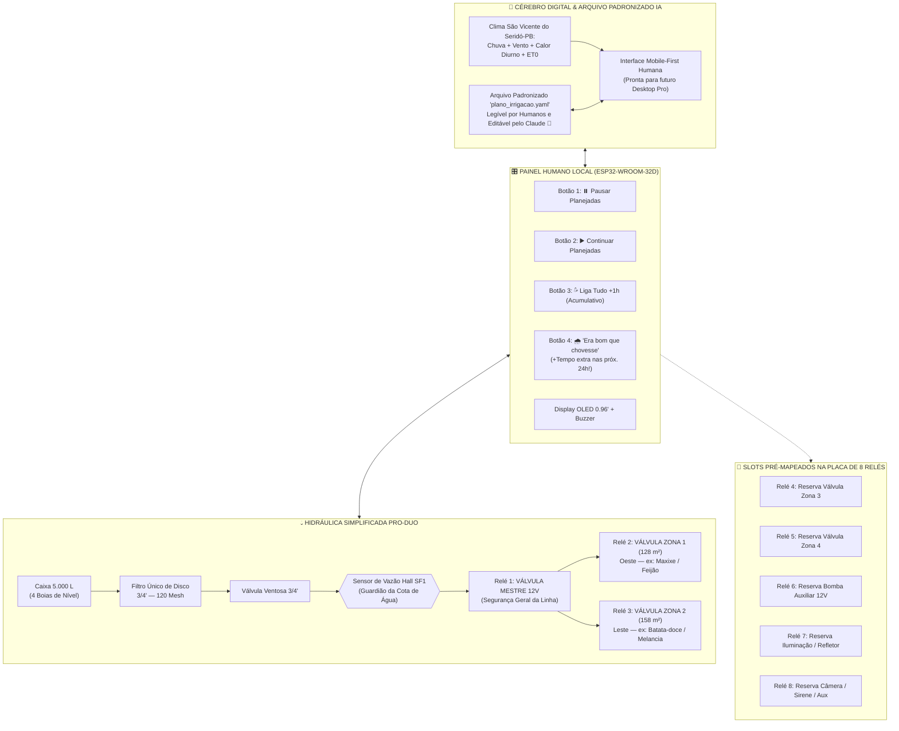

# 🌱 Irriga.ai (Pro-Duo) — Documentação Oficial do MVP Inteligente de 2 Zonas

Bem-vindo à documentação do **Irriga.ai Pro-Duo**: a versão **MVP (Produto Mínimo Viável)** de hardware simplificado, projetada especificamente para dominar com máxima inteligência agronômica, climática e humana o manejo das **duas zonas principais de plantio** do sítio em **São Vicente do Seridó – PB** (`6°57'11.7"S, 36°22'06.7"W`).

Enquanto a pasta [`pro-max/`](file:///c:/irriga-ai/pro-max) documenta a versão de porte máximo (múltiplas válvulas de campo, bomba centrífuga/diafragma 12V e duplo filtro autolimpante por retrolavagem), a versão **`pro-duo/`** entrega **exatamente o mesmo potencial cognitivo e a mesma interface digital completa**, mas com uma instalação física enxuta, barata, rápida de montar e **já pré-cabeada na arquitetura para expansões futuras** (bombas, luzes, câmeras, sensores e novas zonas).

---

## ⚖️ Comparativo Direto: `Pro-Duo` (MVP) vs. `Pro-Max`

| Dimensão | 🌱 **Irriga.ai Pro-Duo (Esta Pasta)** | 🚀 **Irriga.ai Pro-Max (`../pro-max/`)** |
| :--- | :--- | :--- |
| **Foco Principal** | **Simplicidade física + Inteligência máxima** para **2 Zonas de Plantio** (`Zona 1` e `Zona 2`). | **Capacidade física máxima** (até 6–8 zonas + pressurização ativa + retrolavagem). |
| **Placa de Relés** | **1 Placa de 8 Relés**: **3 usados no MVP** (`Válvula Mestre`, `Zona 1`, `Zona 2`) + **5 já pré-alocados no sistema** para expansão (bomba, luzes, câmeras, novas válvulas). | Até 2 Placas de 8 Relés (irrigação multi-zona + manobra de 8 válvulas de purga). |
| **Filtragem** | **1 Único Filtro de Disco 120 Mesh** (limpeza manual simples assistida por alerta de vazão). | Duplo filtro em paralelo com painel de retrolavagem automática contra-corrente. |
| **Medição e Cotas** | **1 Sensor de Vazão Hall (`SF1`)** para garantir que a irrigação **jamais ultrapasse as cotas definidas pelo usuário** + 4 boias de nível da caixa. | Sensores de vazão duplos (`SF1` + `SF2`) + bomba 12V controlada. |
| **Botões Físicos (4x)** | 1. ⏸️ **Pausar** irrigações planejadas 2. ▶️ **Continuar** irrigações planejadas 3. 💦 **Liga Tudo +1h** (acumulativo) 4. 🌧️ **"Era bom que chovesse"** *(adiciona tempo extra de rega em todas as irrigações das próximas 24h!)* | Botões focados em operação industrial (`HOLD`, `RESUME`, `+1h`, `Poupar Água`). |
| **Inteligência Digital** | **100% Completa:** Curva por planta e estágio de crescimento (DAP/$K_c$), previsão de chuva, vento, calor acumulado no dia, UX humana *Mobile-First* e **arquivo `IrrigaPlan` (YAML/JSON) editável pelo Claude/IA**. | Mesma base cognitiva. |

---

## 🗂️ Estrutura da Documentação `pro-duo/`

1. 📄 **[01 — Operação, Os 4 Botões (incluindo *"Era bom que chovesse"*) e Gestão de Cotas](file:///c:/irriga-ai/pro-duo/01_operacao_botoes_e_cotas.md)**
   * Mecânica detalhada dos 4 botões físicos, com foco especial no funcionamento lúdico e agronômico do botão **"Era bom que chovesse"** (+tempo extra nas próximas 24h).
   * Operação coordenada das 3 válvulas iniciais (**Válvula Mestre + Zona 1 + Zona 2**) e controle rígido de cotas de água pelo sensor de vazão.
   * Arquitetura dos **5 canais de relé livres (`Relé 4 a 8`) e GPIOs extras** já contabilizados no código para futuras bombas, refletores LED, câmeras e sensores.

2. 🔧 **[02 — Hidráulica Simplificada (Filtro Único 120 Mesh) e Elétrica com Matriz de Expansão](file:///c:/irriga-ai/pro-duo/02_hidraulica_e_eletrica_simplificada.md)**
   * Diagrama hidráulico enxuto: Caixa $5.000\text{ L} \to$ Filtro 120 Mesh $\to$ Ventosa $\to$ Sensor de Vazão $\to$ Válvula Mestre $\to$ Válvula Zona 1 ($128\text{ m}^2$) e Válvula Zona 2 ($158\text{ m}^2$).
   * Pinout oficial do **ESP32-WROOM-32D (38 Pinos V4)** e tabela de endereçamento dos 8 relés (3 ativos + 5 pré-mapeados).
   * Lista enxuta de hardware (BOM e custos específicos do `Pro-Duo`).

3. 🧠 **[03 — Inteligência Climática (Calor, Vento, Chuva) e Fenologia das 2 Zonas](file:///c:/irriga-ai/pro-duo/03_inteligencia_climatica_e_fenologica.md)**
   * Como o sistema calcula o **estresse térmico diurno** (temperatura máxima, horas de calor $> 32^\circ\text{C}$, rajadas de vento seco e radiação solar em São Vicente do Seridó – PB) para compensar a sede real da planta.
   * Ajuste automático por estágio de crescimento (DAP / $K_c$) para as culturas do guia (ex.: redução de rega na Melancia pré-colheita para apurar o doce, pico na floração do Feijão Verde e Maxixe, tuberização da Batata-doce).

4. 📱 **[04 — Interface Digital Humana (Mobile-First) e Abertura para Desktop](file:///c:/irriga-ai/pro-duo/04_interface_mobile_humana_e_desktop.md)**
   * Design de experiência do usuário (UX) acolhedor, visual e fácil de usar com uma mão no celular, traduzindo dados meteorológicos e agronômicos em frases humanas claras.
   * Arquitetura responsiva e modular que já prepara o terreno para o futuro **Painel Desktop Completo (Command Center)**.

5. 🤖 **[05 — Padrão de Arquivo `IrrigaPlan` (YAML/JSON): Gestão de Irrigação Assistida por IA (Claude)](file:///c:/irriga-ai/pro-duo/05_padrao_arquivo_irrigacao_ia.md)**
   * Como funciona o arquivo padronizado e legível por humanos que comanda as zonas do `Pro-Duo`.
   * Fluxo passo a passo para pedir ao **Claude** (ou outra IA) que monte um plano de safra do zero ou faça ajustes finos, com validação automática de segurança (*Schema Guardrails*) antes de enviar para o ESP32.

6. 📂 **Pasta [`planos/`](file:///c:/irriga-ai/pro-duo/planos) — Arquivos Reais Prontos para Usar com o Claude:**
   * 📄 **[`plano_irrigacao_sitio.yaml`](file:///c:/irriga-ai/pro-duo/planos/plano_irrigacao_sitio.yaml):** Arquivo real de configuração das Zonas 1 e 2, super legível e comentado.
   * 📐 **[`irriga_plan.schema.json`](file:///c:/irriga-ai/pro-duo/planos/irriga_plan.schema.json):** Validador JSON Schema oficial da estrutura do plano.
   * 💬 **[`PROMPT_PARA_O_CLAUDE.md`](file:///c:/irriga-ai/pro-duo/planos/PROMPT_PARA_O_CLAUDE.md):** Template de instrução pronto para você copiar, colar no Claude e gerar/alterar seus planos de irrigação em segundos.

---

## 🏗️ Visão Geral da Arquitetura `Irriga.ai Pro-Duo`

