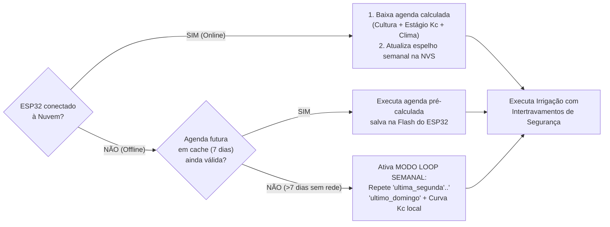
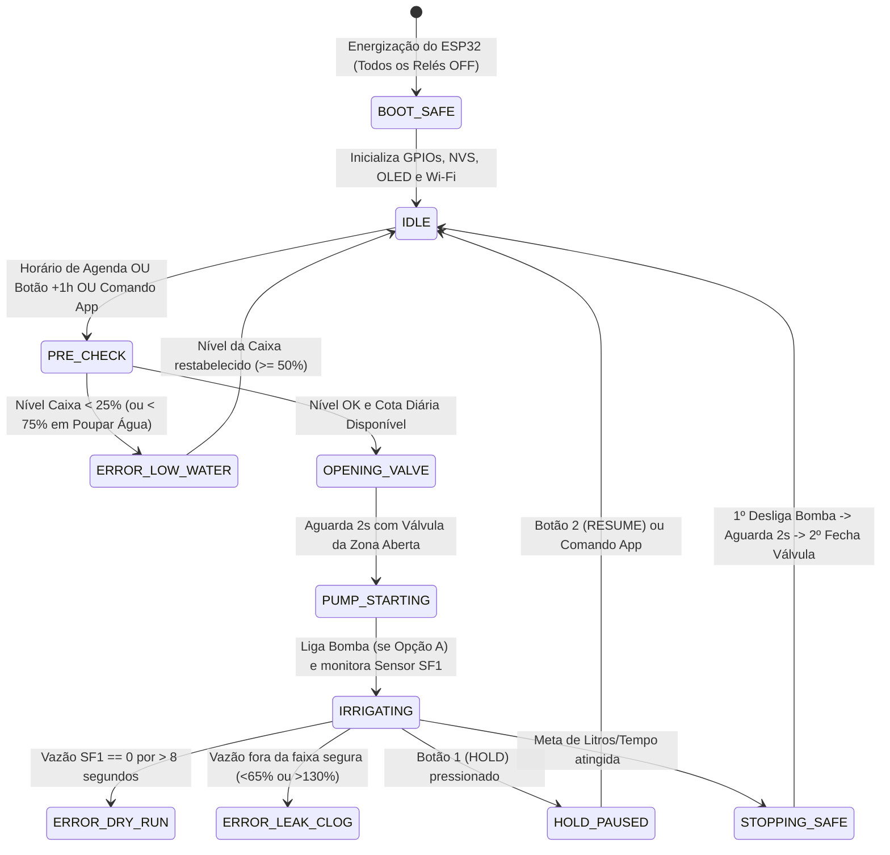

# 01 — Funcionalidades do Sistema, Modos de Operação e Regras de Negócio

Este documento especifica todas as funcionalidades operacionais do **Irriga.ai (Pro-Max)**, detalhando o comportamento do sistema em modo conectado (Online), em modo isolado (Offline/Off-Grid), na operação manual local pelo caseiro (Interface *In-Situ*), na gestão de cota hídrica e nos intertravamentos de segurança hidráulica.

---

## 1. Matriz Geral de Funcionalidades

| Módulo | Funcionalidade | Escopo | Descrição |
| :--- | :--- | :---: | :--- |
| **Controle de Zonas** | Acionamento sequencial ou simultâneo de válvulas solenoides 12V | MVP | Suporte inicial a **2 zonas (Zona A: 128 m² e Zona B: 158 m²)**, com arquitetura pronta na placa de 8 relés para até **6 zonas de plantio** + **1 relé de Bomba** + **1 relé de Válvula Mestre/Purga**. |
| **Agenda Inteligente** | Execução de horários de rega dinâmicos | MVP | Recebe da plataforma online os horários e tempos de rega calculados conforme a **cultura plantada**, os **Dias Após o Plantio (DAP / estágio de desenvolvimento)** e a **previsão meteorológica**. |
| **Modo Offline Resiliente** | "Irrigação Padrão" autônoma sem internet | MVP | Armazena em memória flash não-volátil (`NVS` / `LittleFS`) a programação padrão e o histórico rolante dos últimos 7 dias (`ultima_segunda` a `ultimo_domingo`), repetindo o ciclo previsivelmente caso o Wi-Fi caia. |
| **Painel *In-Situ* (Caseiro)** | 4 botões físicos de intervenção rápida + Display OLED 0.96" + Buzzer | MVP | Permite ao operador local parar tudo, retomar a agenda, adicionar $+1\text{ h}$ de irrigação manual ou ativar o modo **Poupar Água** sem precisar de celular. |
| **Monitoramento da Caixa** | Leitura de 4 níveis discretos ($25\%, 50\%, 75\%, 100\%$) | MVP | Monitora a caixa de $5.000\text{ L}$ via 4 chaves de nível tipo boia magnética, bloqueando a bomba/irrigação em nível crítico e emitindo alertas sonoros/remotos. |
| **Gestão de Cota Diária** | Teto configurável de consumo diário (ex.: $1.000\text{ L/dia}$) | MVP | Limita o volume máximo diário consumido da caixa e distribui a água disponível priorizando as zonas cujas culturas estejam na **fase fenológica mais sensível ao déficit hídrico**. |
| **Diagnóstico de Vazão** | Rotina de *Benchmark* pós-filtro / pós-bomba | MVP / Fase 1.5 | Compara a vazão real lida pelo sensor de fluxo Hall (`L/min`) com o valor de referência (*Benchmark*) calibrado com filtro limpo. Detecta entupimento de filtro, tubulação rompida ou válvula travada. |
| **Integração Meteorológica** | Consulta automática de chuva e $ET_0$ (São Vicente do Seridó – PB) | MVP | Lê a previsão via API Open-Meteo (`-6.95325, -36.36853`) para cancelar, adiar ou ajustar a lâmina de irrigação em dias chuvosos ou de calor extremo. |
| **Retrolavagem Automática** | Painel de purga com 2 filtros em paralelo | Fase 2 | Inverte o fluxo hidráulico usando água limpa de um filtro para lavar o outro contra-corrente quando o diagnóstico de vazão acusar perda de carga. |

---

## 2. Interface Física *In-Situ* (Painel do Caseiro)

O painel físico instalado próximo à caixa d'água foi desenhado para ser operado de forma intuitiva por qualquer trabalhador no campo, mesmo sem smartphone ou conexão à internet. Ele reúne **4 botões de pressão verdes (`PBS-110 NA`)**, **1 Display OLED I2C de 0.96"** e **1 Buzzer Ativo**.

### 2.1. Funções dos 4 Botões Físicos (Unificação dos Rascunhos)

Nos rascunhos originais ([`inicial.md`](file:///c:/irriga-ai/legacy/ContextIngested/inicial.md) e [`Irriga.ai-alpha.png`](file:///c:/irriga-ai/legacy/ContextIngested/Irriga.ai-alpha.png)), os 4 botões apareciam com nomenclaturas complementares. Abaixo está a especificação definitiva unificada para o firmware:

| Botão | Pino ESP32 | Nome no Painel | Ação ao Pressionar (Clique Curto: $< 2\text{ s}$) | Ação ao Segurar (Clique Longo: $\ge 3\text{ s}$) |
| :---: | :---: | :--- | :--- | :--- |
| **Botão 1** | `GPIO 13` | 🛑 **PARAR / HOLD** | **Parada Imediata:** Desliga imediatamente a bomba e fecha todas as válvulas. Pausa a execução atual e coloca o sistema em estado `HOLD` (suspenso por 12h ou até que `RESUME` seja pressionado). | **Bloqueio de Manutenção:** Trava o sistema em `HOLD` por tempo indeterminado até confirmação dupla. |
| **Botão 2** | `GPIO 14` | ▶️ **ACORDAR / RESUME** | **Se a tela estiver apagada:** Acorda o Display OLED por 60 segundos e alterna entre as páginas de status (1: Irrigação Atual, 2: Próximos Agendamentos, 3: Nível da Caixa e Vazão). **Se estiver em `HOLD` ou `POUPAR ÁGUA`:** Cancela a suspensão e retoma a agenda automática normal (`RESUME`). | **Teste de Vazão Manual:** Dispara imediatamente a rotina de diagnóstico de *Benchmark* de vazão de 60 segundos. |
| **Botão 3** | `GPIO 26` | 💦 **IRRIGAR TUDO (+1h)** | **Rega Manual Incrementável:** Inicia a irrigação extraordinária por **1 hora** (respeitando o limite hidráulico de pressão: simultânea ou sequencialmente $30\text{ min}$ Zona A + $30\text{ min}$ Zona B). **Cada clique adicional soma $+1\text{ hora}$** ao contador regressivo (máximo de $4\text{ horas}$ ou até atingir a reserva mínima da caixa). | **Irrigar Apenas Zona A / Alternar Zona:** Permite escolher irrigar manualmente apenas a Zona A ou apenas a Zona B por $30\text{ min}$. |
| **Botão 4** | `GPIO 27` | 🪣 **POUPAR ÁGUA** *(ou "Era bom que chovesse")* | **Modo Economia / Reserva para o Sítio:** Ativa o modo de preservação da caixa d'água pelas próximas **24 horas** (ex.: quando o caseiro precisa da caixa cheia pela manhã para lavar o trator, pulverizar ou uso doméstico, ou quando observa formação de chuva local). Durante esse modo, o sistema **suspende regas não-críticas** ou **bloqueia qualquer consumo abaixo do nível de 75%** da caixa. | **Adiar por Chuva Local (Skip 24h):** Registra que choveu no sítio e pula os agendamentos das próximas 24 horas. |

> [!TIP]
> **Economia de Vida Útil do Display OLED:** Qualquer botão pressionado enquanto o display estiver em *sleep* (apagado após 60 segundos de inatividade) primeiro **acorda a tela e emite 1 bipe curto no buzzer**. Para evitar acionamentos acidentais no escuro, os botões 1, 3 e 4 podem exigir que a tela já esteja acesa (ou um segundo toque em até 5 segundos) para efetivar a ação, exceto o **Botão 1 (PARAR)** que **sempre desliga tudo no primeiro toque por segurança**.

### 2.2. Telas do Display OLED 0.96" (128x64 pixels)

O display opera em 3 telas rotativas (alternadas pelo Botão 2 ou automaticamente a cada 5 segundos quando acordado):

1. **Tela Principal (Operação em Tempo Real):**
   * Linha 1: Status Wi-Fi (`ONLINE` / `OFFLINE-LOOP`) + Hora atual + Ícone de Bomba (`BOMBA: ON/OFF`).
   * Linha 2: Estado atual (`IRRIGANDO ZONA A`, `EM ESPERA`, `HOLD MANUAL`, `POUPAR AGUA`).
   * Linha 3: Barra gráfica do Nível da Caixa (`[■■■□] 75%`) + Vazão instantânea (`14.2 L/min`).
   * Linha 4: Tempo restante da rega atual (`Restam: 00:42:15`) ou Cota do dia (`Cota: 420/1000 L`).
2. **Tela de Agenda (Próximas Irrigações):**
   * Lista os próximos 3 horários programados, a zona correspondente (`ZONA A - Maxixe`, `ZONA B - Melancia`) e a duração prevista.
3. **Tela de Diagnóstico Hidráulico:**
   * Exibe o status do último teste de *Benchmark* de vazão (`Filtro: OK (96%)` ou `ALERTA: LIMPAR FILTRO! (68%)`).

### 2.3. Padrões Sonoros do Buzzer Ativo (`GPIO 2`)

| Evento | Padrão de Bipe | Significado |
| :--- | :--- | :--- |
| **Toque em Botão** | 1 bipe curto ($80\text{ ms}$) | Confirmação tátil/sonora de comando recebido. |
| **Início de Irrigação** | 2 bipes curtos ($100\text{ ms}$) | Aviso de que a bomba/válvula vai pressurizar a linha. |
| **Caixa Cheia (100%)** | 3 bipes suaves espaçados | Aviso opcional quando a caixa atinge $100\%$ durante enchimento. |
| **Caixa Vazia (<25%)** | 1 bipe longo ($1\text{ s}$) a cada 5 min (máx. 3x) | Alerta de bloqueio de irrigação por falta de água na caixa. |
| **Erro Crítico Hidráulico** | Bipes rápidos intermitentes por $10\text{ s}$ | Bomba rodando a seco (`SF1 = 0`), vazamento ou perda severa de vazão. |

---

## 3. Modo Offline / Off-Grid Resiliente ("Irrigação Padrão")

Em propriedades rurais no interior da Paraíba, quedas de energia ou de internet (roteador Wi-Fi desligado, rompimento de fibra regional) não podem interromper a irrigação das culturas. O **Irriga.ai** implementa uma arquitetura de **Autonomia Local em 3 Camadas** gravada na memória Flash (`LittleFS` / `Preferences NVS`) do ESP32:

### Como funciona o Loop Previsível de 7 Dias:
1. **Janela Previsiva de 7 Dias (Cache Primário):** Toda vez que o ESP32 sincroniza com a nuvem, ele não recebe apenas o comando do momento: ele baixa a **programação completa para os próximos 7 dias** (já considerando a curva de estágio da planta). Se a internet cair por 2 ou 3 dias, ele segue essa agenda com precisão.
2. **Memória Rolante por Dia da Semana (`ultima_segunda` .. `ultimo_domingo`):** Toda irrigação executada com sucesso em um dia normal (sem override de chuva) é gravada no registro persistente daquele dia da semana (`schedule_history[dia_da_semana]`).
3. **Perfil Padrão da Cultura Local (*Fallback* Definitivo):** Além do histórico de 7 dias, o próprio ESP32 armazena na memória Flash a tabela compacta das 9 culturas do guia (data de plantio da Zona A e da Zona B e os coeficientes $K_c$ de cada fase). Assim, mesmo que fique **30 dias sem internet**, o ESP32 sabe quantos dias se passaram desde o plantio e **reduz sozinho a água da melancia quando ela entra nos últimos 10 dias antes da colheita**!
4. **Manutenção de Relógio sem Internet:** O ESP32 sincroniza a hora via `NTP` (`a.st1.ntp.br`) sempre que há Wi-Fi e mantém a contagem via RTC interno de hardware. Caso ocorra falta de energia elétrica *e* na volta da luz o Wi-Fi esteja fora do ar, o firmware recupera o último *timestamp* salvo na NVS (atualizado a cada hora) e aplica os horários relativos com base no ciclo diário até que o Wi-Fi retorne.

---

## 4. Gestão da Cota Diária Configurável e Priorização Fenológica

A caixa de $5.000\text{ L}$ abastece o sistema, mas a disponibilidade de água varia entre a estação chuvosa e o auge da seca no Seridó. Por isso, o sistema possui o parâmetro **`daily_water_quota_liters`** (ex.: configurável pelo aplicativo em $1.000\text{ L/dia}$, $1.500\text{ L/dia}$ ou `ILIMITADO`).

### Regra de Alocação e Rateio Inteligente:
Suponha que num dia de pico de calor ($ET_0 = 6,0\text{ mm/dia}$):
* A **Zona A ($128\text{ m}^2$)** com **Batata-doce** em fase final precise de $450\text{ L}$.
* A **Zona B ($158\text{ m}^2$)** com **Melancia** em plena **floração e pegamento de frutos** (fase crítica!) precise de $750\text{ L}$.
* **Demanda Total do Dia:** $450 + 750 = 1.200\text{ L}$.
* **Cota Configurada pelo Usuário:** $1.000\text{ L/dia}$.

Em vez de cortar linearmente as duas zonas (o que prejudicaria a floração da melancia) ou irrigar a primeira e deixar a segunda sem água, o **Irriga.ai** aplica o **Fator de Prioridade Fenológica ($P_f$)**:
1. Culturas que estão na sua **Fase Mais Sensível à Falta d'Água** (conforme mapeado no Guia de Culturas: ex. *Floração/Pegamento* na Melancia, *Início da Frutificação* no Maxixe, *Formação de Raízes 30–70 dias* na Batata-doce, *Floração/Enchimento de Vagens* no Feijão Verde) recebem prioridade máxima ($P_f = 1,0$) e têm até $100\%$ da sua lâmina garantida.
2. O corte necessário para respeitar a cota de $1.000\text{ L}$ ($-200\text{ L}$) é absorvido prioritariamente pela zona cuja cultura esteja em fase vegetativa tolerante ou maturação ($P_f = 0,6$), garantindo que a produtividade comercial da safra não seja comprometida.
3. Se o botão **Poupar Água** estiver ativo, a cota diária é automaticamente reduzida em $50\%$ e um piso de segurança de $75\%$ ($3.750\text{ L}$) é travado na caixa d'água.

---

## 5. Rotina de Diagnóstico e *Benchmark* de Vazão

Conforme especificado nos requisitos do projeto ([`inicial.md` linha 256](file:///c:/irriga-ai/legacy/ContextIngested/inicial.md#L256)), o sistema conta com uma rotina dedicada para aferir a saúde hidráulica após a passagem pelo filtro de disco (e pela bomba, quando presente).

### 5.1. Como funciona o Teste de *Benchmark*:
1. **Posicionamento:** O Sensor de Fluxo Hall (`SF1`) fica instalado logo após o filtro de disco (e após a bomba auxiliar).
2. **Calibração de Referência (*Benchmark*):** Quando o sistema é instalado (ou após o caseiro limpar o filtro de disco), aciona-se o comando **"Calibrar Benchmark"** (pelo App ou segurando o Botão 2). O ESP32 abre a válvula de referência (ou saída de teste/purga próxima, sem a perda de carga longa, ou a própria Zona A padronizada), aguarda $15\text{ segundos}$ para estabilizar a pressão e mede a vazão média durante $30\text{ segundos}$, salvando o valor $Q_{\text{ref}}$ (em $\text{L/min}$) na memória NVS.
3. **Verificação Automática em Todas as Irrigações:** Nos primeiros $60\text{ segundos}$ de cada irrigação normal (e em testes periódicos semanais), o ESP32 compara a vazão atual $Q_{\text{atual}}$ com o $Q_{\text{ref}}$ daquela zona:

| Relação $Q_{\text{atual}} / Q_{\text{ref}}$ | Diagnóstico do Sistema | Ação Automática |
| :---: | :--- | :--- |
| **$85\% \text{ a } 115\%$** | ✅ **Normal** | Irrigação prossegue normalmente; volume real em litros é contabilizado pelo integrador do sensor Hall. |
| **$65\% \text{ a } 84\%$** | ⚠️ **Alerta de Perda de Vazão (Filtro Sujo)** | Sistema compensa aumentando proporcionalmente o tempo de rega para entregar os litros necessários e envia alerta no App/OLED: *"Perda de vazão detectada (Filtro com sujeira). Limpar filtro de disco."* (Na Fase 2, dispara a retrolavagem automática). |
| **$< 65\%$ (ou $< Q_{\text{min}}$)** | 🚨 **Obstrução Severa / Válvula Travada Fechada** | Interrompe a bomba imediatamente, aciona o Buzzer de erro e notifica no celular: *"Falha crítica de vazão na Zona X"*. |
| **$> 130\%$** | 🚨 **Vazamento / Mangueira Solta em Campo** | Vazão muito acima do esperado indica que uma chula, tampão de fim de linha ou fita de gotejo escapou. Fecha a válvula da zona, desliga a bomba e emite alerta de rompimento hidráulico. |

---

## 6. Máquina de Estados (FSM) e Intertravamentos de Segurança (`Safety Interlocks`)

O firmware do ESP32 nunca aciona relés de forma avulsa: toda transição passa pela Máquina de Estados com **8 Regras Rígidas de Intertravamento**:

### As 8 Regras Inegociáveis de Segurança no Código:
1. **Regra do Caminho Aberto Antes da Bomba (Anti-Golpe de Aríete):** A bomba auxiliar (`Relé Bomba`) **jamais** pode ser ligada antes que pelo menos uma válvula de destino (`V1`, `V2`, etc.) esteja aberta há pelo menos **2 segundos**. No desligamento, a ordem é inversa: **primeiro desliga a bomba, aguarda 2 segundos para aliviar a pressão da linha e só então fecha a válvula solenoide**.
2. **Proteção Contra Funcionamento a Seco (*Dry-Run Protection*):** Se a bomba estiver ligada (ou uma válvula aberta) e o Sensor de Fluxo `SF1` registrar vazão zero ($< 0,5\text{ L/min}$) por mais de **8 segundos consecutivos**, o sistema desliga tudo imediatamente e entra em estado de falha com alarme no Buzzer e no App.
3. **Bloqueio por Nível Baixo na Caixa (Histerese):** Se a boia de **Nível 1 (25%)** abrir indicando caixa abaixo de $1.250\text{ L}$, toda irrigação é bloqueada para evitar sucção de ar/fundo da caixa. O sistema só destrava automaticamente quando o nível voltar para **Nível 2 (50%)** (histerese anti-oscilação).
4. **Detecção de Válvula Travada Aberta:** Quando o sistema está em `IDLE` (todas as válvulas comandadas como fechadas), se o sensor de fluxo detectar passagem contínua de água por mais de $15\text{ segundos}$, o sistema aciona o alarme de **"Vazamento / Solenoide não vedou"** (e fecha a válvula mestre `V-MANIFOLD`, se instalada).
5. **Limite de Corrente Simultânea na Fonte 12V:** O escalonador garante que o número máximo de solenoides abertas simultaneamente respeite tanto a vazão máxima do tubo de $25\text{ mm}$ quanto a corrente máxima da fonte de $12\text{ V } 10\text{ A}$. Por padrão no MVP, **irriga-se uma zona por vez** (Zona A e depois Zona B), garantindo pressão máxima e uniforme em todos os gotejadores.
6. **Timeout Máximo de Segurança (*Watchdog* Hidráulico):** Nenhuma válvula pode permanecer aberta ininterruptamente por mais que o tempo máximo de segurança (`MAX_VALVE_ON_TIME = 180 minutos` por ciclo). Um *Hardware Watchdog Timer* (`TWDT`) de $15\text{ segundos}$ reinicia o ESP32 em estado seguro (`OUTPUT LOW` / relés desligados) caso qualquer tarefa de software trave.
7. **Intertravamento de Purga vs. Irrigação (Fase 2):** As válvulas de retrolavagem só podem ser acionadas com a válvula mestre `V-MANIFOLD` fechada, impedindo que água suja de retrolavagem vá para as fitas de gotejamento.
8. **Proteção Elétrica de GPIOs de Entrada:** Os pinos dos botões (`GPIO 13, 14, 26, 27`) e boias de nível (`GPIO 32, 33, 12, 15`), que fecham contato diretamente com o `GND`, são travados por constante de compilação como `INPUT_PULLUP`, com proibição explícita em código de chamada a `pinMode(..., OUTPUT)` nesses pinos.
