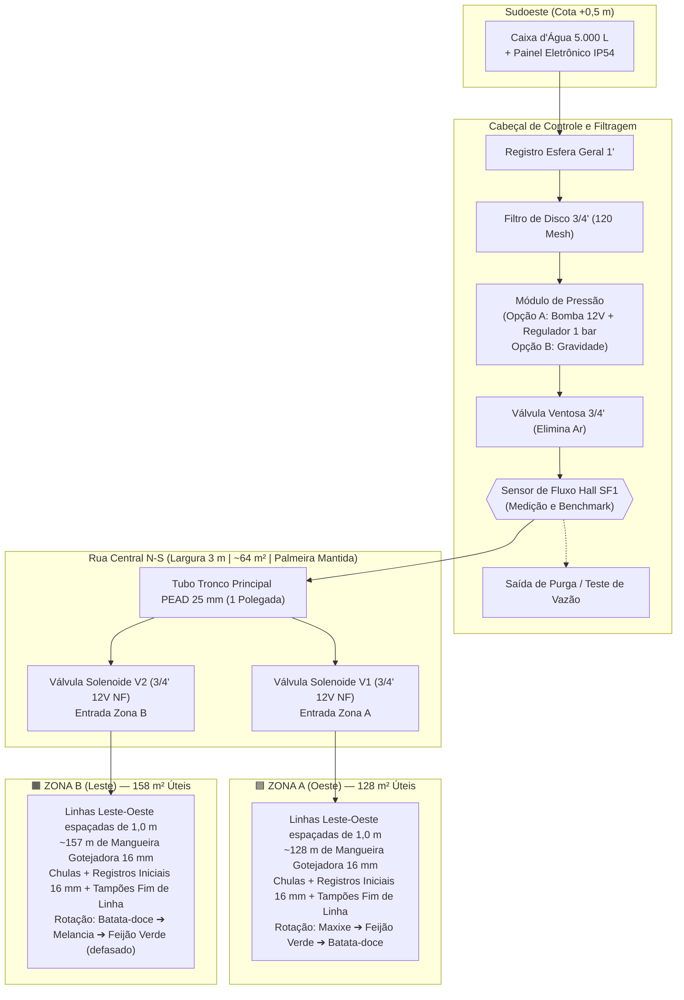
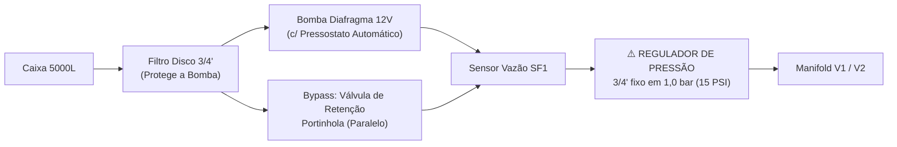
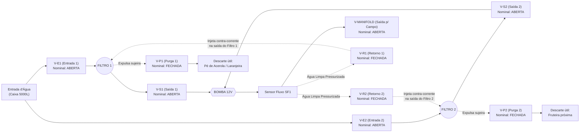

# 02 — Sistema Hidráulico, Layout de Zonas e Opções de Pressurização

Este documento detalha a engenharia hidráulica do **Irriga.ai (Pro-Max)**, abrangendo a implantação física das **Zonas A e B (MVP)** no sítio em São Vicente do Seridó – PB, a análise técnica completa das **duas opções de pressurização** (Com Bomba 12V vs. Gravidade Pura) e a especificação do **Painel de Purga / Retrolavagem Automática** para a Fase 2.

---

## 1. Layout Geoespacial e Dimensionamento de Campo (MVP: 2 Zonas)

O projeto de campo inicial (baseado em [`mapa_2-zonas_irrigacao.png`](file:///c:/irriga-ai/legacy/ContextIngested/mapa_2-zonas_irrigacao.png) e [`VistaDeSatelite.png`](file:///c:/irriga-ai/legacy/ContextIngested/VistaDeSatelite.png)) ocupa um polígono cercado dividido ao meio no sentido Norte-Sul por um corredor de serviço.

### 1.1. Parâmetros Físicos das Zonas (MVP)

| Parâmetro Hidráulico / Geométrico | Zona A (Oeste) | Zona B (Leste) | Total / Sistema |
| :--- | :---: | :---: | :---: |
| **Área Útil de Plantio** | $128\text{ m}^2$ | $158\text{ m}^2$ | **$286\text{ m}^2$** (+ $64\text{ m}^2$ de rua = $350\text{ m}^2$) |
| **Sentido das Linhas de Gotejo** | Leste–Oeste (L–O) | Leste–Oeste (L–O) | Perpendiculares à rua central N–S |
| **Espaçamento entre Linhas** | $1,0\text{ m}$ | $1,0\text{ m}$ | $1,0\text{ m}$ entre fitas |
| **Comprimento de Fita Gotejadora 16 mm** | $\approx 128\text{ m}$ | $\approx 157\text{ m}$ | **$\approx 285\text{ m}$** (1 rolo de $300\text{ m}$ no orçamento) |
| **Quantidade Estimada de Linhas Laterais** | $14\text{ a }16\text{ linhas}$ | $15\text{ a }17\text{ linhas}$ | $\approx 30\text{ a }33\text{ linhas}$ (kit vem com $50$ registros + $50$ tampões) |
| **Tubulação Principal (Adutora + Derivação)** | PEAD $25\text{ mm}$ ($1"$) | PEAD $25\text{ mm}$ ($1"$) | Sobe pelo centro da Rua de $3\text{ m}$ contornando a palmeira |
| **Conexão Tubo $25\text{ mm} \to$ Fita $16\text{ mm}$** | Furo com broca $16\text{ mm}$ + Chula de vedação + Registro Inicial $16\text{ mm}$ | Furo com broca $16\text{ mm}$ + Chula de vedação + Registro Inicial $16\text{ mm}$ | Permite fechar linhas individuais (ex.: espaçamento de $2\text{ m}$ para Melancia/Jerimum!) |
| **Fechamento das Linhas** | Tampão Final de Linha $16\text{ mm}$ com rosca | Tampão Final de Linha $16\text{ mm}$ com rosca | Permite abrir a ponta da fita para descarga de limpeza (*flushing*) |

> [!TIP]
> **Por que os Registros Iniciais Individuais em cada linha de 16 mm são uma grande vantagem agronômica?**
> Como as linhas estão espaçadas a cada $1,0\text{ m}$, você atende perfeitamente **Batata-doce ($1,0\text{ m}$)** e **Feijão Verde ($2\text{ fileiras por linha}$)**. Quando plantar **Melancia ($2,0\text{ m}$ entre fileiras)**, **Maxixe ($2,0\text{ m}$)** ou **Jerimum ($2,0\text{ a }3,0\text{ m}$)**, basta **fechar os registros manuais das linhas pares** naquela safra! Não é preciso desmontar nem mudar nenhuma mangueira de lugar.

### 1.2. Cálculo de Vazão e Tempo de Rega por Zona

Existem duas configurações de fita gotejadora consideradas nos documentos do projeto:
1. **Configuração do Mapa (`mapa_2-zonas_irrigacao.png`):** Gotejadores a cada **$1,0\text{ m}$** ($\approx 128$ gotejadores na Zona A e $\approx 157$ na Zona B). Com vazão nominal de $2,0\text{ L/h}$ por emissor:
   * **Vazão Zona A:** $128 \times 2,0\text{ L/h} = \mathbf{256\text{ L/h}}$ ($\approx \mathbf{4,27\text{ L/min}}$) $\implies$ Aplica $2,0\text{ mm/hora}$.
   * **Vazão Zona B:** $157 \times 2,0\text{ L/h} = \mathbf{314\text{ L/h}}$ ($\approx \mathbf{5,23\text{ L/min}}$) $\implies$ Aplica $2,0\text{ mm/hora}$.
2. **Configuração do Carrinho do Mercado Livre (*Mangueira Gotejamento Drip Plan 16mm 300m 30x30cm*):** Gotejadores a cada **$0,30\text{ m}$** ($3,33\text{ gotejadores/m}$), excelente para formar faixa úmida contínua para Feijão Verde e Batata-doce. Com vazão nominal de $1,6\text{ L/h}$ por emissor a $1\text{ bar}$ ($\approx 5,33\text{ L/h}$ por metro linear):
   * **Vazão Zona A (todas as linhas abertas):** $128\text{ m} \times 5,33\text{ L/h} = \mathbf{682\text{ L/h}}$ ($\approx \mathbf{11,37\text{ L/min}}$) $\implies$ Aplica $5,33\text{ mm/hora}$ (uma lâmina diária de $4,0\text{ mm} = 512\text{ L}$ é entregue em apenas **$45\text{ minutos}$**!).
   * **Vazão Zona B (com metade das linhas abertas para Melancia a $2,0\text{ m}$):** $79\text{ m} \times 5,33\text{ L/h} = \mathbf{421\text{ L/h}}$ ($\approx \mathbf{7,0\text{ L/min}}$).
   * **Vazão Zona B (todas as linhas abertas):** $157\text{ m} \times 5,33\text{ L/h} = \mathbf{837\text{ L/h}}$ ($\approx \mathbf{13,95\text{ L/min}}$).

> [!IMPORTANT]
> **Autocalibração pelo Sensor de Vazão (`SF1`):** O software do **Irriga.ai** permite informar a vazão nominal da zona, mas **usa a leitura real do Sensor de Vazão Hall (`L/min`)** para totalizar exatamente os **Litros entregues** ($\text{Litros} = \text{Área m}^2 \times \text{Lâmina mm}$). Assim, independentemente de a pressão oscilar ou de algumas linhas manuais estarem fechadas para Melancia, a zona sempre recebe o volume exato de água necessário!

---

## 2. Análise das Duas Opções de Pressurização (Decisão de Engenharia)

Como a caixa de $5.000\text{ L}$ encontra-se atualmente cerca de **$0,5\text{ m}$ acima da área de plantio**, a pressão estática natural disponível por gravidade é de apenas:
$$P_{\text{gravidade}} = 0,5\text{ m.c.a.} \approx 0,05\text{ bar} \approx 0,005\text{ MPa} \approx 0,7\text{ PSI}$$

Abaixo estão documentadas as **duas arquiteturas possíveis** para que você possa escolher ou transitar entre elas com segurança:

### Opção A — Pressurização Ativa com Bomba Auxiliar 12V (Recomendada se a caixa permanecer a $0,5\text{ m}$)

#### Por que usar a Bomba Auxiliar?
1. **Abertura das Solenoides Irrimax 3/4" 12V NF:** As válvulas solenoides de irrigação padrão de mercado (como a *Irrimax 3/4" 12V NF* de R$ 42,90 do orçamento) são válvulas **de diafragma servo-operadas (pilotadas)**. A bobina 12V abre apenas um micro-orifício piloto, e é a própria pressão da água que empurra o diafragma principal para cima. Elas exigem uma **pressão mínima de trabalho de $0,02\text{ MPa}$ ($0,2\text{ bar} = 2,0\text{ m.c.a.}$)**. Com apenas $0,5\text{ m.c.a.}$, a solenoide pilotada abre apenas um fio de água ou não abre.
2. **Uniformidade nos Gotejadores:** A fita gotejadora *Drip Plan 16mm* projeta sua vazão nominal e uniformidade de distribuição ao longo dos $150\text{ m}$ operando entre **$0,5\text{ bar e }1,2\text{ bar}$ ($5\text{ a }12\text{ m.c.a.}$)**.
3. **Viabiliza a Retrolavagem Futura:** Na Fase 2, limpar um filtro contra-corrente exige pressão e velocidade de arraste que só a bomba fornece.

#### Cuidados Obrigatórios na Montagem da Opção A:

* **Filtro ANTES da Bomba:** O filtro de disco deve ficar na sucção/entrada da bomba para que grãos de areia não perfurem o diafragma da bomba 12V.
* **Regulador de Pressão Pós-Bomba ($1,0\text{ bar} / 15\text{ PSI}$):** Bombas de diafragma 12V atingem de $70\text{ a }130\text{ PSI}$ ($5\text{ a }9\text{ bar}$) quando restringidas, o que **expulsa as chulas e rasga a fita gotejadora de 16 mm** (que suporta no máximo $1,2\text{ a }1,5\text{ bar}$). Um **Regulador de Pressão de Rosca 3/4" para 15 PSI (1,0 bar)** (custo $\approx\text{R\$ 35 a R\$ 45}$) antes do manifold protege toda a rede de gotejamento.
* **Escolha da Bomba 12V:** Para atender até $11\text{ a }14\text{ L/min}$ por zona (ou irrigação sequencial Zona A $\to$ Zona B), escolha uma **Bomba de Diafragma 12V de Duplo Núcleo ou Alta Vazão ($10\text{ a }16\text{ L/min}$, corrente de $6\text{ A a }8\text{ A}$)** com pressostato integrado.

---

### Opção B — Sistema por Gravidade Pura (Sem Bomba Elétrica)

Caso deseje operar o MVP **sem bomba elétrica** (consumo de energia quase zero, silêncio total e menos uma peça mecânica para manutenção), existem **dois caminhos técnicos viáveis**:

| Sub-opção | O que fazer na instalação | Impacto nas Válvulas e Gotejamento |
| :--- | :--- | :--- |
| **B1. Elevar a Caixa (ou Caixa Auxiliar) para $\ge 2,5\text{ m}$ de desnível** | Posicionar a base da caixa a pelo menos $2,5\text{ a }3,0\text{ m}$ acima do terreno ($\ge 0,25\text{ a }0,30\text{ bar}$). | ✅ **Funciona direto com todos os itens do carrinho atual!** As solenoides *Irrimax 3/4" 12V NF* abrem normalmente (pois $0,25\text{ bar} > 0,20\text{ bar}$ mínimo) e a fita gotejadora opera em baixa pressão com boa distribuição (apenas levando cerca de $1,6\times$ mais tempo para entregar os mesmos litros, o que o ESP32 ajusta sozinho via `SF1`). |
| **B2. Manter a Caixa a $0,5\text{ m}$ e usar Válvulas "Zero-Pressão"** | Manter a caixa no nível atual ($0,5\text{ m.c.a.}$) e trocar as 3 solenoides pilotadas por **Válvulas Motorizadas de Esfera 12V 3/4"** (ou Solenoides de Ação Direta Zero-Pressão $0\text{–}1\text{ bar}$). | ✅ **Elimina a perda de carga na válvula!** A válvula de esfera motorizada abre um furo reto de $100\%$ da passagem do cano de $3/4"$ mesmo com $0,0\text{ bar}$ de pressão. Nesse caso, os gotejadores gotejarão lentamente ($\approx 30\%\text{ a }40\%$ da vazão nominal), exigindo tempos de rega mais longos (ex.: $2\text{ a }3\text{ horas}$ por zona) e nivelamento cuidadoso das linhas Leste–Oeste. |

> [!WARNING]
> **Regra da Válvula de Retenção na Gravidade ($0,5\text{ m}$):** Se operar na Opção B2 (gravidade a $0,5\text{ m}$), **não utilize válvula de retenção com mola dura**, pois a mola sozinha consome $0,5\text{ a }1,5\text{ m.c.a.}$ para abrir e bloqueará a água. Se precisar de retenção em baixa pressão, utilize exclusivamente **Válvula de Retenção Horizontal de Portinhola (Clapeta)** sem mola.

---

## 3. Expansão Fase 2: Novas Zonas e Painel de Purga / Retrolavagem Automática

A arquitetura hidráulica e elétrica do **Irriga.ai (Pro-Max)** já deixa previsto o crescimento da propriedade para as duas frentes desenhadas em [`Irriga.ai-alpha.png`](file:///c:/irriga-ai/legacy/ContextIngested/Irriga.ai-alpha.png):

### 3.1. Expansão do Manifold para até 6 Zonas de Cultivo
Na placa principal de 8 relés (`R1`), os canais são alocados para permitir expansão imediata sem trocar o controlador:
* **Canal 1 (`V1`):** Zona A (Oeste – $128\text{ m}^2$: Rotação Hortaliças/Raízes)
* **Canal 2 (`V2`):** Zona B (Leste – $158\text{ m}^2$: Rotação Melancia/Raízes/Leguminosas)
* **Canal 3 (`V3`):** Zona C — **Capim** (Forragem animal)
* **Canal 4 (`V4`):** Zona D — **Laranjas** (Pomar cítrico / fruteiras perenes)
* **Canal 5 (`V5`):** Zona E — **Palma Forrageira** (Baixíssima demanda hídrica, rega quinzenal/mensal de salvamento na seca)
* **Canal 6 (`V6`):** Zona F — Reserva para expansão futura (ex.: Jerimum / Macaxeira em área anexa)
* **Canal 7 (`V-MANIFOLD`):** Válvula Mestre do Manifold / Isolamento para Purga e Teste de Vazão
* **Canal 8 (`BOMBA`):** Relé de comando da Bomba Auxiliar 12V

---

### 3.2. Funcionamento Detalhado do Painel de Purga Automática (Fase 2)

No diagrama [`Irriga.ai-alpha.png`](file:///c:/irriga-ai/legacy/ContextIngested/Irriga.ai-alpha.png) (lado direito), foi projetado um sistema inteligente de **duplo filtro em paralelo com retrolavagem cruzada** para quando a água da caixa contiver partículas ou algas frequentes.

#### Decodificação dos Triângulos Verdes e Vermelhos do Diagrama Alpha (Tabela Verdade):
No desenho original (`Irriga.ai-alpha.png`), cada válvula possui um bloco com `NOMINAL: N`, `1 ➔ 1` e `2 ➔ 2`, onde **Triângulo Verde = Válvula Aberta (Passagem Livre)** e **Triângulo Vermelho = Válvula Fechada (Bloqueada)**:

| Modo de Operação | Filtro 1: Entrada (`V-E1`) | Filtro 1: Saída (`V-S1`) | Filtro 1: Purga (`V-P1`) | Filtro 1: Retorno (`V-R1`) | Filtro 2: Entrada (`V-E2`) | Filtro 2: Saída (`V-S2`) | Filtro 2: Purga (`V-P2`) | Filtro 2: Retorno (`V-R2`) | Saída Campo (`V-MANIFOLD`) | Explicação do Fluxo Hidráulico |
| :--- | :---: | :---: | :---: | :---: | :---: | :---: | :---: | :---: | :---: | :--- |
| **Modo `N` (Nominal / Irrigação Normal)** | 🟢 Aberta | 🟢 Aberta | 🔴 Fechada | 🔴 Fechada | 🟢 Aberta | 🟢 Aberta | 🔴 Fechada | 🔴 Fechada | 🟢 Aberta | Água passa pelos **2 filtros em paralelo** (dobro de área filtrante, metade da perda de carga), passa pela bomba e vai para o manifold irrigar a lavoura. |
| **Modo `1` (Retrolavagem do Filtro 1)** | 🔴 Fechada | 🔴 Fechada | 🟢 Aberta | 🟢 Aberta | 🟢 Aberta | 🟢 Aberta | 🔴 Fechada | 🔴 Fechada | 🔴 Fechada | A bomba suga água **limpa através do Filtro 2**, bloqueia a ida para o campo (`V-MANIFOLD` fechada) e injeta essa água limpa pressurizada por `V-R1` **de trás para frente no Filtro 1**, expulsando toda a sujeira acumulada por `V-P1` (que irriga uma árvore próxima para não desperdiçar água!). |
| **Modo `2` (Retrolavagem do Filtro 2)** | 🟢 Aberta | 🟢 Aberta | 🔴 Fechada | 🔴 Fechada | 🔴 Fechada | 🔴 Fechada | 🟢 Aberta | 🟢 Aberta | 🔴 Fechada | O inverso exato: a bomba suga água **limpa pelo Filtro 1** e a injeta contra-corrente por `V-R2` através do **Filtro 2**, expulsando a sujeira por `V-P2`. |

> [!TIP]
> **Economia de Pinos e Relés na Fase 2 (Otimização de Engenharia):**
> Observe na Tabela Verdade acima que no **Modo 1**, as 4 válvulas `V-E1`, `V-S1`, `V-P1` e `V-R1` mudam de estado **exatamente juntas**! E no **Modo 2**, as 4 válvulas `V-E2`, `V-S2`, `V-P2` e `V-R2` também mudam de estado **exatamente juntas**!
> Isso significa que na Fase 2 você **não precisa gastar 8 pinos do ESP32 nem 8 canais de relé independentes**:
> * Basta usar válvulas **Normalmente Abertas (NA)** para `V-E` e `V-S` (ou acionar em grupo) e **Normalmente Fechadas (NF)** para `V-P` e `V-R`, acionando **todo o grupo de Purga do Filtro 1 com apenas 1 canal de relé** e **todo o grupo de Purga do Filtro 2 com apenas 1 segundo canal de relé**!
