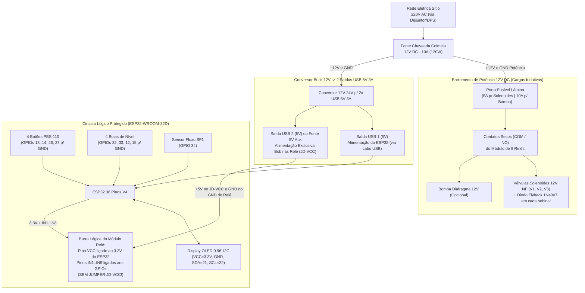

# 03 — Sistema Elétrico, Pinout Oficial do ESP32 e Segurança de Hardware

Este documento consolida o projeto elétrico do **Irriga.ai (Pro-Max)**, definindo o modelo exato do microcontrolador selecionado nas cotações, o mapeamento definitivo de pinos (Pinout), o diagrama de distribuição de potência ($220\text{ V AC} \to 12\text{ V DC} \to 5\text{ V DC} \to 3,3\text{ V DC}$) e as regras de proteção contra surtos indutivos (EMI), corrosão e curto-circuito.

---

## 1. Microcontrolador Homologado (Identificado nas Capturas de Tela)

Nas capturas de tela do orçamento do Mercado Livre ([`screenshot-2026-11-06-194119.png`](file:///c:/irriga-ai/legacy/ContextIngested/screenshot-2026-11-06-194119.png) e [`Minimo-Prototipagem-screenshot-2026-11-06-195510.png`](file:///c:/irriga-ai/legacy/ContextIngested/Minimo-Prototipagem-screenshot-2026-11-06-195510.png)), o modelo exato especificado é:

* **Modelo:** **ESP32-WROOM-32D – 38 Pinos – Nova Versão V4 DevKitC** (Preço de referência: R$ 58,96).
* **Arquitetura:** Xtensa® Dual-Core 32-bit LX6 ($240\text{ MHz}$), $520\text{ KB}$ SRAM, $4\text{ MB}$ Flash, Wi-Fi $802.11\text{ b/g/n}$ ($2,4\text{ GHz}$) e Bluetooth BLE 4.2.

> [!IMPORTANT]
> **Nota de Consolidação Técnica (`ESP32-WROOM-32D` vs. `ESP32-S3`):**
> Em um dos rascunhos preliminares ([`irriga_ai_rascunho_v0.md`](file:///c:/irriga-ai/legacy/ContextIngested/irriga_ai_rascunho_v0.md)) havia menção genérica ao `ESP32-S3`, enquanto o manual de pinos ([`inicial.md`](file:///c:/irriga-ai/legacy/ContextIngested/inicial.md)) e o carrinho de compras real utilizam o **ESP32-WROOM-32D 38 Pinos V4 DevKitC**.
> Toda a documentação oficial **Pro-Max** e o mapeamento de pinos abaixo seguem rigorosamente a arquitetura do **ESP32-WROOM-32D 38 Pinos V4 DevKitC** adquirido no carrinho. *(No WROOM-32D, os pinos `GPIO 6 a 11` são dedicados à memória Flash SPI interna e jamais devem ser usados, e os pinos `GPIO 34, 35, 36 e 39` são entradas puras `INPUT ONLY` sem pull-up interno).*

---

## 2. Mapeamento Oficial e Definitivo de Pinos (Pinout Pro-Max)

Este pinout unifica o **Setup Otimizado de 8 Relés** (do [`inicial.md`](file:///c:/irriga-ai/legacy/ContextIngested/inicial.md#L154-L215)) com os **Sensores de Vazão Hall** e **Monitoramento Analógico**, eliminando completamente o acionamento de relés em pinos críticos de boot (`GPIO 0`, `GPIO 12`, `GPIO 15`) e dispensando resistores externos nos botões e nas 4 boias de nível.

### 2.1. Barramento I2C — Display Local

| Componente | Pino ESP32 | Função | Direção | Notas de Implementação |
| :--- | :---: | :---: | :---: | :--- |
| **Display OLED 0.96" (SSD1306)** | **`GPIO 21`** | `SDA` | Bidirecional | Dados I2C padrão (Endereço `0x3C`). Alimentar `VCC` do OLED com `3.3V`. |
| **Display OLED 0.96" (SSD1306)** | **`GPIO 22`** | `SCL` | Saída Clock | Clock I2C padrão ($100\text{ kHz}$ para maior imunidade a ruído no cabo). |

### 2.2. Interface de Botões Locais (*In-Situ* / Painel do Caseiro)
*Cada botão verde `PBS-110 (NA)` é ligado diretamente entre o pino do ESP32 e o barramento `GND` lógico.*

| Botão | Pino ESP32 | Função no Sistema | Modo no Código | Nível Lógico |
| :--- | :---: | :--- | :---: | :--- |
| **Botão 01** | **`GPIO 13`** | 🛑 **PARAR / HOLD** (Emergência / Pausa) | `INPUT_PULLUP` | Repouso: `HIGH` ($3,3\text{V}$) $\to$ Pressionado: `LOW` ($0\text{V}$) |
| **Botão 02** | **`GPIO 14`** | ▶️ **ACORDAR TELA / RESUME** (Retomar) | `INPUT_PULLUP` | Repouso: `HIGH` ($3,3\text{V}$) $\to$ Pressionado: `LOW` ($0\text{V}$) |
| **Botão 03** | **`GPIO 26`** | 💦 **IRRIGAR TUDO (+1h)** (Incrementável) | `INPUT_PULLUP` | Repouso: `HIGH` ($3,3\text{V}$) $\to$ Pressionado: `LOW` ($0\text{V}$) |
| **Botão 04** | **`GPIO 27`** | 🪣 **POUPAR ÁGUA** ("Era bom que chovesse") | `INPUT_PULLUP` | Repouso: `HIGH` ($3,3\text{V}$) $\to$ Pressionado: `LOW` ($0\text{V}$) |

### 2.3. Sensores de Nível da Caixa d'Água (4 Boias Magnéticas — Sem Resistor Externo)
*Utiliza **4 Chaves de Nível Tipo Boia Magnética (*Reed Switch* selado)** instaladas em tubo guia PVC nas alturas de $25\%, 50\%, 75\%$ e $100\%$ da caixa de $5.000\text{ L}$. Um fio de cada boia vai ao `GND` do ESP32 e o outro vai direto ao pino GPIO correspondente.*

| Nível da Caixa (5.000 L) | Pino ESP32 | Modo no Código | Requisito de Hardware e Boot |
| :--- | :---: | :---: | :--- |
| **Nível 1 — 25% ($1.250\text{ L}$)** | **`GPIO 32`** | `INPUT_PULLUP` | Ligação direta (pull-up interno de $45\text{ k}\Omega$ ativo). |
| **Nível 2 — 50% ($2.500\text{ L}$)** | **`GPIO 33`** | `INPUT_PULLUP` | Ligação direta (pull-up interno de $45\text{ k}\Omega$ ativo). |
| **Nível 3 — 75% ($3.750\text{ L}$)** | **`GPIO 12`** | `INPUT_PULLUP` | Ligação direta. *(Nota: No boot do WROOM-32D, `GPIO 12` em `LOW` ou flutuante seleciona $3,3\text{V}$ para a Flash interna, que é o padrão correto. Nunca coloque resistor externo puxando o `GPIO 12` para `3.3V`!).* |
| **Nível 4 — 100% ($5.000\text{ L}$)** | **`GPIO 15`** | `INPUT_PULLUP` | Ligação direta. |

> [!TIP]
> **Por que Boias Magnéticas (*Reed Switch*) em vez de Hastes Metálicas Nuas?**
> Hastes condutivas nuas submersas com tensão contínua ($3,3\text{V DC}$ dos pull-ups contra o `GND` no fundo da caixa) sofrem **eletrólise galvânica contínua**: em poucas semanas as hastes oxidam, criam uma camada isolante de calcário/zinabre e param de conduzir, além de liberarem íons metálicos na água. As **boias magnéticas de polipropileno (`PP`)** mantêm o contato elétrico 100% isolado da água dentro de uma ampola de vidro hermética acionada por ímã, durando anos sem manutenção e usando **exatamente o mesmo código e os mesmos 4 pinos (`INPUT_PULLUP`)**!

### 2.4. Sensores Hidráulicos de Vazão e Expansão Analógica (Entradas Dedicadas)
*Aproveita os pinos `INPUT ONLY` do ESP32 (`GPIO 34, 35, 36, 39`), que ficaram livres no remanejamento dos níveis.*

| Sensor / Expansão | Pino ESP32 | Modo no Código | Notas Elétricas |
| :--- | :---: | :---: | :--- |
| **Sensor de Vazão Hall `SF1` (Pós-Filtro/Bomba)** | **`GPIO 34`** | `INPUT` (Interrupção `FALLING`) | Pino sem pull-up interno. Usar resistor de $10\text{ k}\Omega$ entre `GPIO 34` e `3.3V` (ou divisor resistivo $10\text{ k}\Omega / 20\text{ k}\Omega$ se o sensor for alimentado em $5\text{V}$). |
| **Sensor de Vazão Hall `SF2` (Pós-Manifold / Opcional)** | **`GPIO 35`** | `INPUT` (Interrupção `FALLING`) | Mesma configuração do `SF1`. |
| **Entrada Analógica Livre 1 (Pressão / Bateria Solar)** | **`GPIO 36` (`VP`)** | `ADC1_CH0` | Livre para leitura de tensão da bateria 12V (Fase Solar) ou transdutor de pressão ($0,5\text{–}4,5\text{V}$). |
| **Entrada Analógica Livre 2 (Umidade de Solo)** | **`GPIO 39` (`VN`)** | `ADC1_CH3` | Livre para futuro sensor capacitivo de umidade do solo. |

### 2.5. Atuadores e Sinalização (Módulo de 8 Relés + Buzzer)
*Todos os pinos de saída para relés são pinos seguros de propósito geral (`GPIO`). Como o módulo de 8 relés com optoacoplador é acionado em **Nível Baixo (`Active LOW`)**, no `setup()` do código deve-se escrever `digitalWrite(pin, HIGH)` **antes** de `pinMode(pin, OUTPUT)` para evitar que os relés pulem ligados no milissegundo da inicialização.*

| Canal / Atuador | Pino ESP32 | Função Hidráulica (MVP e Expansão) | Lógica de Acionamento |
| :--- | :---: | :--- | :---: |
| **Relé 01 (`IN1`)** | **`GPIO 4`** | **`V1` — Solenoide Zona A** (Oeste – $128\text{ m}^2$) | `LOW` = Liga / `HIGH` = Desliga |
| **Relé 02 (`IN2`)** | **`GPIO 16`** | **`V2` — Solenoide Zona B** (Leste – $158\text{ m}^2$) | `LOW` = Liga / `HIGH` = Desliga |
| **Relé 03 (`IN3`)** | **`GPIO 17`** | **`V3` — Solenoide 3** (Saída Teste/Purga no MVP ou **Zona C: Capim**) | `LOW` = Liga / `HIGH` = Desliga |
| **Relé 04 (`IN4`)** | **`GPIO 18`** | **`V4` — Expansão Zona D** (**Laranjas**) | `LOW` = Liga / `HIGH` = Desliga |
| **Relé 05 (`IN5`)** | **`GPIO 19`** | **`V5` — Expansão Zona E** (**Palma Forrageira**) | `LOW` = Liga / `HIGH` = Desliga |
| **Relé 06 (`IN6`)** | **`GPIO 23`** | **`V6` — Expansão Zona F** (ou Grupo Purga Filtro 1 na Fase 2) | `LOW` = Liga / `HIGH` = Desliga |
| **Relé 07 (`IN7`)** | **`GPIO 25`** | **`V7` — `V-MANIFOLD` Mestre** (ou Grupo Purga Filtro 2 na Fase 2) | `LOW` = Liga / `HIGH` = Desliga |
| **Relé 08 (`IN8`)** | **`GPIO 5`** | **`BOMBA` — Bomba Auxiliar 12V** (Comando de potência) | `LOW` = Liga / `HIGH` = Desliga |
| **Buzzer Ativo** | **`GPIO 2`** | **Alarme Sonoro do Painel** (Bipes de interface e alertas) | `HIGH` = Toca / `LOW` = Silêncio |

---

## 3. Arquitetura de Potência e Isolamento Elétrico Total

O diagrama abaixo mostra como os componentes do carrinho do Mercado Livre (**Fonte Colmeia 12V 10A** + **Conversor 12V-24V para 2x USB 5V 3A** + **ESP32** + **Módulo Relé 8 Canais**) devem ser interligados dentro da **Caixa de Comando Hermética IP54 ($40 \times 30 \times 20\text{ cm}$)**:

---

## 4. As 5 Regras de Ouro de Segurança Elétrica e Blindagem EMI

### Regra 1: Isolamento Óptico no Módulo de 8 Relés (`Jumper JD-VCC Removido`)
1. **Remova o jumper plástico** que une os pinos `JD-VCC` e `VCC` na placa de 8 relés.
2. Ligue os $+5\text{V}$ da alimentação de relés no pino **`JD-VCC`** e o negativo no **`GND`** lateral da placa de relés.
3. Ligue o pino **`VCC`** (da barra principal junto aos pinos `IN1..IN8`) exclusivamente no pino **`3.3V` do ESP32**, e os pinos `IN1..IN8` nos GPIOs definidos na Seção 2.5.
4. **Não interligue o `GND` do ESP32 ao pino `GND` da placa de relés** se estiver usando uma fonte USB de $5\text{V}$ independente para o ESP32: assim a comunicação entre o ESP32 e a placa de relés ocorre **100% por luz (dentro dos optoacopladores)**, impedindo que qualquer pico elétrico das bobinas chegue ao processador ou trave o display OLED.

### Regra 2: Diodos de Roda-Livre (*Flyback Diodes* `1N4007`) nas Solenoides 12V e Bomba
Quando uma válvula solenoide de $12\text{ V DC}$ ou uma bomba de diafragma é desligada, o colapso do campo magnético da bobina gera um pulso reverso de alta tensão (*Back-EMF* de $-100\text{ V a }-300\text{ V}$) que faisca nos contatos do relé e irradia uma onda eletromagnética capaz de **reiniciar o ESP32 ou embaralhar os caracteres do Display OLED**.
* **Solução Obrigatória (Custo < R$ 2,00):** Instale um diodo retificador comum **`1N4007`** em paralelo com os terminais de cada válvula solenoide 12V (e da bomba 12V), o mais próximo possível da bobina:
  * **Faixa prateada do diodo (Catodo)** ligada no fio **Positivo (`+12V`)** da solenoide.
  * **Lado preto do diodo (Anodo)** ligado no fio **Negativo (`GND 12V`)** da solenoide.
* Isso absorve instantaneamente o pico indutivo no momento do desligamento, multiplicando por $10\times$ a vida útil dos contatos dos relés e mantendo o OLED 100% estável.

### Regra 3: Proibição Absoluta de `OUTPUT HIGH` em Pinos de Botões e Boias
Conforme destacado em [`inicial.md` (linha 27)](file:///c:/irriga-ai/legacy/ContextIngested/inicial.md#L27):
> ⚠️ **Atenção Crítica:** Como os 4 botões (`GPIO 13, 14, 26, 27`) e as 4 boias de nível (`GPIO 32, 33, 12, 15`) fecham contato físico direto com o **`GND`**, você **JAMAIS** deve configurar qualquer um desses pinos no código como `OUTPUT` e nível `HIGH`. Se um pino em `OUTPUT HIGH` ($3,3\text{V}$ direto sem resistor limitador) for conectado ao `GND` pelo fechamento de um botão ou boia, ocorrerá um **curto-circuito direto pelo transistor interno do pino** ($> 40\text{ mA}$), queimando a porta ou o ESP32 inteiro!
* Sempre configure esses 8 pinos exclusivamente como `pinMode(pino, INPUT_PULLUP)`. No modo `INPUT_PULLUP`, a corrente ao fechar contato com o `GND` é limitada pelo resistor interno de $45\text{ k}\Omega$ a meros **$0,07\text{ mA}$ ($73\text{ }\mu\text{A}$)** — totalmente seguro mesmo em curto permanente.

### Regra 4: Dimensionamento do Cabo PP $2 \times 2,5\text{ mm}^2$ (Rolo de 50 m do Orçamento)
O rolo de **Cabo PP $2 \times 2,5\text{ mm}^2$ ($50\text{ m}$)** selecionado no orçamento possui resistência ôhmica de apenas $\approx 0,0074\text{ }\Omega/\text{m}$ por condutor ($0,0148\text{ }\Omega/\text{m}$ ida e volta):
* **Para alimentar uma Válvula Solenoide 12V ($\approx 0,5\text{ A}$ / $6\text{ W}$) a $30\text{ m}$ de distância:**
  $$\Delta V = 30\text{ m} \times 0,0148\text{ }\Omega/\text{m} \times 0,5\text{ A} = \mathbf{0,22\text{ V de queda}}$$
  Chegam **$11,78\text{ V}$** na válvula (perfeito!).
* **Para levar energia $220\text{ V AC}$ da sede do sítio até a Caixa de Comando IP54 a $50\text{ m}$ de distância:** Suporta até $21\text{ A}$ ($> 4.500\text{ W}$) com folga total.
* **Separação Física na Caixa IP54 ($40 \times 30 \times 20\text{ cm}$):** Monte a Fonte Colmeia 12V e a placa de 8 relés na metade inferior da caixa metálica, e posicione o ESP32 e o Display OLED na metade superior, mantendo a distância mínima recomendada de **$10\text{ a }15\text{ cm}$** entre os relés e o microcontrolador.

### Regra 5: Adaptação de Nível Lógico para o Sensor de Vazão Hall (`SF1`)
Sensores de vazão de efeito Hall de $3/4"$ (ex.: `YF-S201` ou `YF-B5`) geralmente operam alimentados em $5\text{ V}$ e emitem pulsos quadrados na mesma tensão de alimentação. Como os GPIOs do ESP32 são para **$3,3\text{ V}$** (não tolerantes a $5\text{ V}$):
* Conecte um **divisor resistivo simples** no fio amarelo (Sinal) do sensor: um resistor de **$10\text{ k}\Omega$** em série entre o fio amarelo e o `GPIO 34`, e um resistor de **$20\text{ k}\Omega$** (ou dois de $10\text{ k}\Omega$ em série) entre o `GPIO 34` e o `GND`. Isso converte o pulso de $5,0\text{ V}$ para **$3,33\text{ V}$** exatos.
