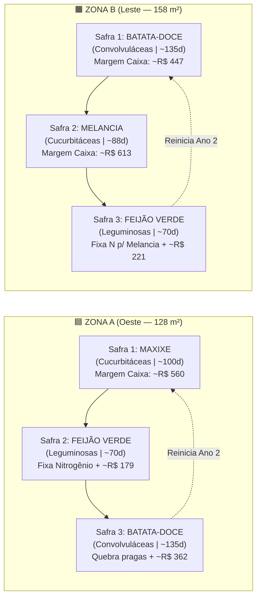

# 04 — Inteligência Agronômica, Guia de Culturas, Curvas Fenológicas ($K_c$) e Algoritmo Climático

Este documento consolida todos os parâmetros agronômicos e econômicos extraídos do [`guia_culturas_gotejamento.pdf`](file:///c:/irriga-ai/legacy/ContextIngested/guia_culturas_gotejamento.pdf), o plano de rotação das **Zonas A ($128\text{ m}^2$) e B ($158\text{ m}^2$)**, a modelagem matemática dos **estágios de desenvolvimento da cultura (fases fenológicas)** e a integração com a previsão meteorológica para **São Vicente do Seridó – PB** (`6°57'11.7"S, 36°22'06.7"W`).

---

## 1. Base de Dados Oficial das 9 Culturas para Gotejamento

### 1.1. Ciclo, Demanda Hídrica, Espaçamento e Manejo
*(1 mm de lâmina d'água = 1 Litro por $\text{m}^2$. Valores de referência com irrigação por gotejamento sem descontar chuva).*

| Cultura | Família Botânica (Rotação) | Ciclo (Dias) | Espaçamento Recomendado (m) | Água Total no Ciclo ($\text{mm} = \text{L/m}^2$) | Água Média ($\text{mm/dia}$) | Fase Mais Sensível à Falta d'Água (Crítica) | Dificuldade (1–5) | Regras de Manejo e Dicas Operacionais |
| :--- | :--- | :---: | :--- | :---: | :---: | :--- | :---: | :--- |
| **Maxixe** | Cucurbitáceas | $90\text{–}110$ *(colhe a partir do dia 55–60)* | $1,5\text{–}2,0 \times 0,5$ (tutor) ou $2,0 \times 1,0$ (rasteiro) | $400$ | **$4,0$** | **Início da frutificação** | 3 | Tutorar reduz doenças e facilita a colheita; colher a cada $2\text{–}3\text{ dias}$. |
| **Melancia** | Cucurbitáceas | $80\text{–}95$ | $2,0 \times 0,8\text{–}1,0$ *(1 linha a cada 2 m)* | $400$ | **$4,4$** | **Floração e pegamento de frutos** | 4 | **Reduzir a rega 7–10 dias antes da colheita melhora o açúcar (°Brix)**; ramas ocupam $3\text{–}4\text{ m}$. |
| **Batata-doce** | Convolvuláceas | $120\text{–}150$ | $1,0 \times 0,30$ (leiras) | $450$ | **$3,5$** | **Formação das raízes ($30\text{–}70\text{ dias}$)** | 2 | Mudas são ramas (barato); evitar excesso de nitrogênio; suporta calor intenso. |
| **Feijão verde** | Leguminosas | $60\text{–}75$ | $0,50 \times 0,20$ *(2 fileiras por linha de gotejo)* | $300$ | **$4,3$** | **Floração e enchimento de vagens** | 3 | **Fixa nitrogênio no solo**: excelente antes de milho, maxixe ou melancia. Colheita escalonada. |
| **Jerimum** | Cucurbitáceas | $100\text{–}120$ | $3,0 \times 1,0$ (ou $2,0 \times 1,0$) | $450$ | **$4,1$** | **Floração e enchimento de frutos** | 2 | Ocupa bastante espaço; frutos pós-colheita duram semanas (dá folga para comercializar). |
| **Milho verde** | Gramíneas | $75\text{–}90$ | $0,90 \times 0,20\text{–}0,25$ | $450$ | **$5,3$** | **Pendoamento e espigamento** | 3 | Plantar em blocos ($\ge 4\text{ fileiras}$ para polinização); vento forte pode acamar; exige adubação pesada. |
| **Macaxeira** | Euforbiáceas | $240\text{–}360$ ($8\text{–}12\text{ m}$) | $1,0 \times 0,60$ | $850$ | **$2,8$** | **Primeiros 3 meses (pegamento)** | 1 | Tolera seca moderada após o 3º mês; ocupa a área o ano todo; colheita escalonada. |
| **Mandioca** | Euforbiáceas | $360\text{–}540$ ($12\text{–}18\text{ m}$) | $1,0 \times 0,60$ | $1000$ | **$2,2$** | **Primeiros 3 meses (pegamento)** | 1 | Variedades para farinha/fécula; não compensa em área muito pequena salvo comprador certo. |
| **Batatinha** | Solanáceas | $90\text{–}110$ | $0,80 \times 0,30$ | $450$ | **$4,5$** | **Tuberização** | 5 | Exige noites amenas; no calor do semiárido a produção cai e a requeima é severa (evitar no verão). |

---

### 1.2. Indicadores Econômicos, Custos e Rentabilidade por $\text{m}^2$
*(Referência CEASA-CE Maracanaú / Conab / Cepea. Preço ao produtor = $75\%$ do atacado; receita líquida de $6\%$ de perdas/frete; dias ocupados = ciclo médio + $15\text{ dias}$ de preparo do solo).*

| Cultura | Produtividade Conservadora ($\text{kg/m}^2$) | Preço Atacado Ref. ($\text{R\$/kg}$) | Preço ao Produtor ($\text{R\$/kg}$) | Receita Bruta ($\text{R\$/m}^2$) | Insumos ($\text{R\$/m}^2$) | Margem de Caixa ($\text{R\$/m}^2\text{/ciclo}$) | Mão de Obra ($\text{DH/ha}$) | Margem Após MO ($\text{R\$/m}^2\text{/ciclo}$) | Dias Ocupados (c/ preparo) | Margem de Caixa por Dia ($\text{R\$/m}^2\text{/dia}$) | Veredito para o Sítio |
| :--- | :---: | :---: | :---: | :---: | :---: | :---: | :---: | :---: | :---: | :---: | :--- |
| **1. Maxixe** | $1,20$ | $\text{R\$ } 6,00$ | $\text{R\$ } 4,50$ | $5,08$ | $0,70$ | **$4,38$** | $250$ | $2,13$ | $115$ | **$0,038$** | ⭐ **Ótimo** (com comprador fixo: feira/restaurante). |
| **2. Melancia** | $3,00$ | $\text{R\$ } 2,40$ | $\text{R\$ } 1,80$ | $5,08$ | $1,20$ | **$3,88$** | $110$ | **$2,89$** | $105$ | **$0,037$** | ⭐ **Ótimo** (maior retorno líquido após mão de obra!). |
| **3. Batata-doce** | $1,60$ | $\text{R\$ } 3,00$ | $\text{R\$ } 2,25$ | $3,38$ | $0,55$ | **$2,83$** | $120$ | $1,75$ | $145$ | **$0,020$** | ⭐ **Muito Bom** (rústica, baixo custo, base da rotação). |
| **4. Feijão verde** | $0,35$ | $\text{R\$ } 7,50$ | $\text{R\$ } 5,62$ | $1,85$ | $0,45$ | **$1,40$** | $170$ | $-0,13$ | $85$ | **$0,016$** | ✅ **Bom** (ciclo rápido, fixa nitrogênio para a próxima safra). |
| **5. Jerimum** | $1,20$ | $\text{R\$ } 3,00$ | $\text{R\$ } 2,25$ | $2,54$ | $0,60$ | **$1,94$** | $70$ | $1,31$ | $125$ | **$0,016$** | 🆗 **Regular/Bom** (exige pouquíssimo trabalho e estoca bem). |
| **6. Batatinha** | $1,00$ | $\text{R\$ } 5,80$ | $\text{R\$ } 4,35$ | $4,09$ | $2,50$ | **$1,59$** | $170$ | $0,06$ | $115$ | **$0,014$** | ❌ **Não recomendada** para o calor do Seridó. |
| **7. Milho verde** | $4,0\text{ esp.}$ | $\text{R\$ } 0,70\text{/esp}$ | $\text{R\$ } 0,52\text{/esp}$ | $1,97$ | $0,90$ | **$1,07$** | $90$ | $0,26$ | $100$ | **$0,011$** | ⚠️ **Sazonal** (só vale plantar visando colheita em São João/Junho). |
| **8. Macaxeira** | $2,00$ | $\text{R\$ } 2,50$ | $\text{R\$ } 1,88$ | $3,52$ | $0,50$ | **$3,02$** | $100$ | $2,12$ | $315$ | **$0,010$** | ⚠️ **Apenas para áreas extras** (prende a área nobre por 10 meses). |
| **9. Mandioca** | $2,00$ | $\text{R\$ } 0,60$ | $\text{R\$ } 0,51$ | $0,96$ | $0,40$ | **$0,56$** | $100$ | $-0,34$ | $465$ | **$0,001$** | ❌ **Não compensa** em pequena escala. |

---

## 2. Plano Oficial de Rotação de Culturas (Zonas A e B)

Seguindo a regra fitossanitária áurea do Guia (*"Jamais plante a mesma família botânica em ciclos seguidos na mesma zona; deixe pelo menos um ciclo de outra família entre Cucurbitáceas e utilize Leguminosas para repor nitrogênio"*), o sistema já vem pré-configurado com a rotação tripla do mapa:



* **Por que essa combinação é ideal?**
  1. Enquanto a **Zona A** está com uma Cucurbitácea (**Maxixe**), a **Zona B** está com uma Convolvulácea (**Batata-doce**), evitando que mosca-branca e oídio se multipliquem simultaneamente nas duas metades do terreno.
  2. O **Feijão Verde** entra em momentos diferentes nas duas zonas (fase deslocada), diluindo o pico de trabalho manual de colheita de vagens e preparando o solo rico em nitrogênio antes das culturas mais exigentes (**Melancia** e **Maxixe**).
  3. **Receita Anual Estimada (apenas Zonas A + B = $286\text{ m}^2$):** Soma cerca de **R$ 2.382,00 de margem de caixa líquida por ano** (já descontados os insumos!), pagando todo o investimento do sistema no primeiro ano de operação.

---

## 3. Motor Fenológico Dinâmico: Irrigação por Estágio da Cultura ($K_c$)

Um dos diferenciais centrais do **Irriga.ai (Pro-Max)** é que a quantidade diária de água **não é estática ao longo do ciclo**. Quando o usuário registra no aplicativo que plantou uma cultura na Zona A ou B na data $D_0$, o sistema calcula diariamente os **Dias Após o Plantio ($\text{DAP} = \text{Hoje} - D_0$)** e identifica automaticamente em qual **Estágio Fenológico** a planta se encontra.

### 3.1. Curva de Coeficiente de Cultura ($K_c$) por Fase de Desenvolvimento

Abaixo está a tabela parametrizada no banco de dados e na memória Flash do ESP32 para as culturas principais (baseada nos coeficientes FAO-56 adaptados ao Guia de Culturas do projeto):

| Cultura | Ciclo Base (dias) | **Fase I — Inicial / Germinação e Pegamento** | **Fase II — Crescimento Vegetativo / Ramas** | **Fase III — Floração e Frutificação / Tuberização (PICO CRÍTICO)** | **Fase IV-A — Maturação Inicial / Colheita Contínua** | **Fase IV-B — Pré-Colheita Final (Acúmulo de Açúcar / Cura)** |
| :--- | :---: | :--- | :--- | :--- | :--- | :--- |
| **Melancia** | $88\text{ d}$ | **DAP 1–18**<br>$K_c = 0,45$<br>*(~2,2 mm/dia)* | **DAP 19–42**<br>$K_c = 0,75$<br>*(~3,8 mm/dia)* | **DAP 43–68** 🚨<br>$K_c = 1,05$<br>*(~5,5 mm/dia)* | **DAP 69–78**<br>$K_c = 0,75$<br>*(~3,8 mm/dia)* | **DAP 79–88 (Últimos 10d)** 🍉<br>**$K_c = 0,35$ (~1,5 mm/dia)**<br>*Corte de 65% p/ concentrar açúcar (°Brix) e evitar rachadura!* |
| **Maxixe** | $100\text{ d}$ | **DAP 1–20**<br>$K_c = 0,50$<br>*(~2,5 mm/dia)* | **DAP 21–42**<br>$K_c = 0,80$<br>*(~3,8 mm/dia)* | **DAP 43–60** 🚨<br>$K_c = 1,00$<br>*(~4,8 mm/dia)* | **DAP 61–90** *(Colheita)*<br>$K_c = 0,90$<br>*(~4,3 mm/dia)* | **DAP 91–100**<br>$K_c = 0,65$<br>*(~3,0 mm/dia — final de ciclo)* |
| **Batata-doce** | $130\text{ d}$ | **DAP 1–20**<br>$K_c = 0,50$<br>*(~2,5 mm/dia)* | **DAP 21–30**<br>$K_c = 0,75$<br>*(~3,5 mm/dia)* | **DAP 31–75** 🚨<br>$K_c = 1,10$<br>*(~5,0 mm/dia)* | **DAP 76–115**<br>$K_c = 0,75$<br>*(~3,5 mm/dia)* | **DAP 116–130 (Últimos 15d)** 🍠<br>**$K_c = 0,30$ (~1,2 mm/dia)**<br>*Secagem pré-colheita para evitar podridão e facilitar cura!* |
| **Feijão verde** | $68\text{ d}$ | **DAP 1–15**<br>$K_c = 0,45$<br>*(~2,2 mm/dia)* | **DAP 16–32**<br>$K_c = 0,75$<br>*(~3,8 mm/dia)* | **DAP 33–55** 🚨<br>$K_c = 1,10$<br>*(~5,4 mm/dia)* | **DAP 56–68** *(Colheita vagens)*<br>$K_c = 0,80$<br>*(~4,0 mm/dia)* | *(Colhido ainda verde; mantém umidade moderada até a última apanha)* |
| **Jerimum** | $110\text{ d}$ | **DAP 1–22**<br>$K_c = 0,45$<br>*(~2,2 mm/dia)* | **DAP 23–50**<br>$K_c = 0,75$<br>*(~3,7 mm/dia)* | **DAP 51–85** 🚨<br>$K_c = 1,00$<br>*(~5,0 mm/dia)* | **DAP 86–98**<br>$K_c = 0,70$<br>*(~3,5 mm/dia)* | **DAP 99–110 (Últimos 12d)**<br>**$K_c = 0,35$ (~1,5 mm/dia)**<br>*Melhora conservação pós-colheita.* |
| **Milho verde** | $82\text{ d}$ | **DAP 1–18**<br>$K_c = 0,45$<br>*(~2,5 mm/dia)* | **DAP 19–42**<br>$K_c = 0,85$<br>*(~4,5 mm/dia)* | **DAP 43–68** 🚨<br>$K_c = 1,20$<br>*(~6,4 mm/dia)* | **DAP 69–82** *(Grão leitoso)*<br>$K_c = 0,95$<br>*(~5,0 mm/dia)* | *(Colhido no ponto leitoso para consumo verde)* |
| **Macaxeira** | $300\text{ d}$ | **DAP 1–90** 🚨<br>$K_c = 0,65$<br>*(~3,2 mm/dia)* | **DAP 91–180**<br>$K_c = 0,80$<br>*(~3,8 mm/dia)* | **DAP 181–240**<br>$K_c = 0,60$<br>*(~2,8 mm/dia)* | **DAP 241–285**<br>$K_c = 0,40$<br>*(~1,9 mm/dia)* | **DAP 286–300**<br>$K_c = 0,25$<br>*(Solo mais seco facilita arranquio)* |

> [!IMPORTANT]
> **Exemplo Prático Automatizado (Melancia na Zona B — $158\text{ m}^2$):**
> * **No Dia 50 (Floração e Pegamento de Frutos):** Com $ET_0 = 5,2\text{ mm/dia}$ em São Vicente do Seridó, o sistema aplica $K_c = 1,05 \implies \text{Lâmina} = 5,46\text{ mm/dia} \implies \mathbf{862\text{ Litros/dia}}$ na Zona B (prioridade máxima!).
> * **No Dia 80 (8 dias antes da colheita):** O sistema detecta automaticamente que a melancia entrou na **Fase IV-B (Concentração de Açúcar / °Brix)**, reduzindo o $K_c$ para **$0,35$** $\implies \text{Lâmina} = 1,82\text{ mm/dia} \implies \mathbf{287\text{ Litros/dia}}$ (economia de $575\text{ L/dia}$ de água e melancias muito mais doces e valorizadas!).

---

## 4. Integração Meteorológica e Balanço Hídrico Diário (São Vicente do Seridó – PB)

Para ajustar a irrigação ao clima real do Seridó paraibano sem exigir uma estação meteorológica cara no primeiro momento, a plataforma consulta gratuitamente a **API Open-Meteo** para as coordenadas exatas do sítio (`latitude = -6.95325`, `longitude = -36.36853`).

### 4.1. Endpoint Oficial de Consulta Meteorológica
```http
GET https://api.open-meteo.com/v1/forecast?latitude=-6.95325&longitude=-36.36853&daily=et0_fao_evapotranspiration,precipitation_sum,precipitation_probability_max,temperature_2m_max,wind_speed_10m_max&timezone=America%2FFortaleza&past_days=1&forecast_days=7
```

### 4.2. Equação do Algoritmo de Decisão Diária

Todas as madrugadas (ex.: às `04:30 BRT`, antes do primeiro turno de irrigação das `05:30`), o motor de cálculo executa os 5 passos abaixo para cada zona ativa:

1. **Obtenção da Evapotranspiração de Referência ($ET_0$):**
   * Se **Online**: Usa o `et0_fao_evapotranspiration` do dia fornecido pela Open-Meteo (calculado por Penman-Monteith FAO-56 para `-6.95325, -36.36853`).
   * Se **Offline**: Usa a constante histórica do semiárido para o mês corrente (ou a `Água Média (mm/dia)` da cultura no Guia multiplicada pelo fator de fase).
2. **Cálculo da Demanda da Cultura no Estágio Atual ($ET_c$):**
   $$ET_c\text{ (mm/dia)} = ET_0 \times K_c(\text{Cultura}, \text{DAP})$$
3. **Desconto de Chuva Recente e Previsão de Chuva Iminente ($P_{\text{ef}}$):**
   * **Regra 1 (Chuva nas últimas 24h):** Desconta $80\%$ da precipitação acumulada ontem (`precipitation_sum[ontem] * 0.80`) como chuva efetiva armazenada na zona radicular.
   * **Regra 2 (Chuva Forte Prevista para Hoje):** Se a probabilidade de chuva de hoje for **`precipitation_probability_max >= 75%`** E o volume previsto for **`precipitation_sum[hoje] >= 6.0 mm`**:
     * **Se a cultura NÃO estiver na Fase III Crítica:** O sistema **suspende a rega da manhã** e agenda uma reavaliação às `15:00`. Se a chuva não se confirmar até a tarde, executa uma rega de compensação às `16:00`!
     * **Se a cultura ESTIVER na Fase III Crítica (ex.: floração da melancia):** Aplica preventivamente $50\%$ da lâmina pela manhã (seguro contra erro de previsão) e avalia os outros $50\%$ à tarde.
4. **Cálculo do Volume Líquido e Aplicação de Eficiência do Gotejamento ($E_a = 90\%$):**
   $$\text{Lâmina Líquida } (L_{\text{liq}}) = \max\left(0,\; ET_c - P_{\text{ef}}\right)$$
   $$\text{Volume da Zona (Litros)} = \frac{L_{\text{liq}}\text{ (mm)} \times \text{Área da Zona (m}^2\text{)}}{0,90}$$
5. **Fracionamento em 2 Turnos de Rega (Manhã Cedo e Final da Tarde):**
   * No clima quente e ventoso de São Vicente do Seridó, irrigar nas horas de sol a pino ($10\text{h às }15\text{h}$) aumenta as perdas por evaporação direta e aquece a água parada nos tubos PEAD pretos (podendo escaldar raízes jovens).
   * Por padrão, o **Irriga.ai** divide o volume diário em **2 pulsos** (ex.: **$60\%$ às `05:30`** e **$40\%$ às `16:30`**), mantendo o bulbo úmido constante na raiz sem percolação profunda!
