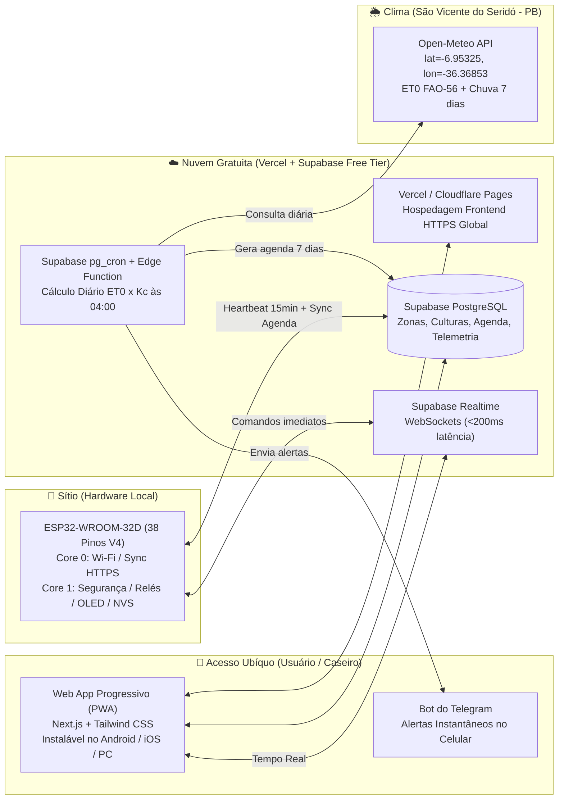
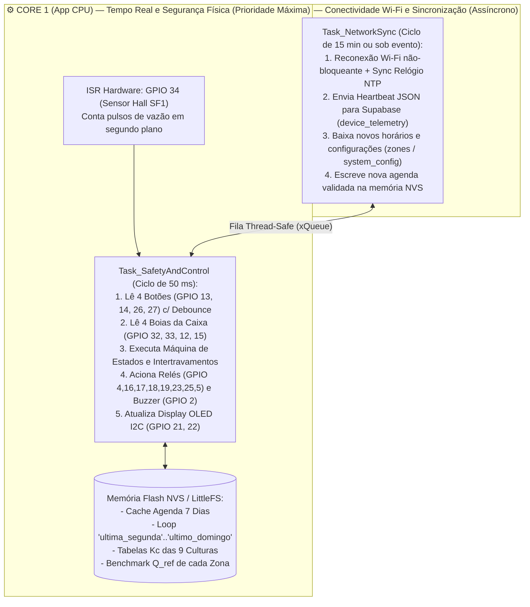

# 05 — Arquitetura de Software, Firmware ESP32 e Interface Online Ubíqua

Este documento define a arquitetura de software de ponta a ponta do **Irriga.ai (Pro-Max)**, abrangendo a escolha da plataforma de nuvem (foco em **Custo R$ 0,00/mês** com experiência de usuário premium), as telas da interface online ubíqua, o esquema do banco de dados, o protocolo de sincronização e a arquitetura multitarefa do firmware no **ESP32-WROOM-32D**.

---

## 1. Decisão de Arquitetura Cloud: Stack 100% Gratuito vs. Opcionais Pagos

Para atender ao requisito de uma **interface online ubíqua** (acessível de qualquer lugar pelo celular ou computador, com atualização em tempo real, leitura de previsão do tempo e cálculo por estágio da cultura) **sem custos mensais fixos**, foi selecionada a seguinte arquitetura moderna:



### 1.1. Por que essa combinação entrega a melhor UX a R$ 0,00/mês?

| Camada | Tecnologia Escolhida | Custo Mensal | Por que foi escolhida e como eliminar limitações do plano gratuito |
| :--- | :--- | :---: | :--- |
| **Interface Web / Mobile** | **Next.js (React) como PWA** hospedado na **Vercel** (ou Cloudflare Pages) | **R$ 0,00** | Funciona como aplicativo nativo no Android e iPhone (ícone na tela inicial, tela cheia, notificações *Web Push*), sem precisar pagar US$ 99/ano da Apple App Store nem US$ 25 da Google Play. |
| **Banco de Dados, Auth e Tempo Real** | **Supabase (Free Tier)** (PostgreSQL + Realtime + Edge Functions + `pg_cron`) | **R$ 0,00** | Oferece $500\text{ MB}$ de banco PostgreSQL (suficiente para $> 5\text{ anos}$ de logs do sítio) e $500.000$ execuções de Edge Functions/mês.<br>💡 **Truque Técnico Anti-Pausa:** O plano gratuito do Supabase pausa bancos que fiquem $7\text{ dias}$ sem queries SQL. Como o **ESP32 envia um *heartbeat* de telemetria a cada 15 minutos** e o `pg_cron` roda todo dia às `04:00`, **o banco recebe milhares de queries por semana e JAMAIS é pausado!** |
| **Previsão do Tempo e $ET_0$** | **Open-Meteo Forecast API** | **R$ 0,00** | Não exige cartão de crédito nem chave de API; fornece até $10.000$ chamadas/dia gratuitas e já entrega a **Evapotranspiração FAO-56 (`et0_fao_evapotranspiration`)** pronta em $\text{mm/dia}$ para as coordenadas exatas do sítio. |
| **Alertas Críticos no Celular** | **Telegram Bot API** + **Web Push** | **R$ 0,00** | Enquanto APIs de SMS ou WhatsApp oficial cobram por mensagem, um Bot do Telegram envia alertas instantâneos no celular (com botões interativos como `[Parar Bomba]` ou `[Adiar Rega]`) de forma 100% gratuita e ilimitada. |

### 1.2. Quando valeria a pena pagar algum serviço? (Análise Transparente)

1. **Domínio Próprio Personalizado (ex.: `irriga.seusitio.com.br`) — Opcional (~R$ 40,00/ano no Registro.br):** O gratuito já fornece um endereço como `irriga-ai.vercel.app`. Pagar R$ 40/ano serve apenas para estética.
2. **Notificações via WhatsApp (ex.: Z-API / Evolution API / Twilio) — Opcional (~R$ 30 a R$ 60/mês):** Só faz sentido se o caseiro usar exclusivamente WhatsApp e não puder instalar o Telegram ou o PWA.
3. **Supabase Pro (US$ 25/mês):** Só será necessário se no futuro você transformar o **Irriga.ai** em um produto comercial (SaaS) atendendo dezenas de propriedades rurais simultaneamente com backups diários *Point-in-Time*. Para o seu sítio, o Free Tier com *heartbeat* ativo atende com 100% de confiabilidade.

---

## 2. Design e Funcionalidades da Interface Online Ubíqua (PWA)

A interface foi projetada com **UX amigável para usuários leigos e rápida para gestão técnica**, dividida em **5 abas principais**:

### Aba 1: Painel Ao Vivo (*Dashboard*)
* **Widget da Caixa d'Água (5.000 L):** Ilustração visual com o nível atual ($100\%, 75\%, 50\%, 25\%$ ou $<25\%\text{ Crítico}$), volume estimado em litros e indicador se o modo **🪣 Poupar Água** está ativo.
* **Status Hidráulico em Tempo Real:**
  * Estado atual (`Em Espera`, `Irrigando Zona A`, `Irrigando Zona B`, `Pausado pelo Caseiro - HOLD`).
  * Indicador luminoso da **Bomba Auxiliar 12V** (`LIGADA` / `DESLIGADA`) e velocímetro de **Vazão Instantânea** (`11,4 L/min` vs. Benchmark esperado).
  * Barra de **Cota Diária de Água**: ex. `Consumido hoje: 640 L / Cota: 1.000 L` (com botão rápido para alterar a cota do dia).
* **Card Clima de São Vicente do Seridó – PB:** Temperatura atual/máxima, probabilidade e milímetros de chuva hoje/amanhã, $ET_0$ do dia e selo de decisão da IA (ex.: *"☀️ Sol forte (ET0: 5,6 mm) — Lâmina ajustada em +12%"* ou *"🌧️ 85% chance de chuva (12 mm) — Rega da manhã adiada"*).
* **Controles Rápidos Remotos:** Botões de 1 toque para `▶️ Irrigar Zona A/B Agora`, `🛑 Parar Tudo (HOLD)`, `🪣 Ativar Poupar Água (24h)`.

### Aba 2: Zonas de Plantio & Estágio Fenológico (Coração Agronômico)
Para cada zona (**Zona A: 128 m²**, **Zona B: 158 m²** e zonas futuras **Capim**, **Laranjas**, **Palma**):
* **Seletor da Cultura Atual e Data de Plantio:** O usuário escolhe p. ex. `Melancia` na Zona B e informa `Data do Plantio: 20/08/2026`.
* **Linha do Tempo do Desenvolvimento (DAP):**
  * Mostra visualmente: **`Dia 78 de 88 (88% concluído) — Fase IV-B: Maturação / Pré-Colheita`**.
  * Exibe um banner explicativo automático:
    > 🍉 **Ajuste Fenológico Ativo:** A melancia está a 10 dias da colheita. O sistema reduziu automaticamente o coeficiente de irrigação ($K_c$) de $1,05$ para **$0,35$ ($-65\%$ de água)** para concentrar o açúcar nos frutos e evitar rachaduras.
* **Configuração Física da Zona:** Permite informar quantas linhas de gotejo estão abertas naquela safra (ex.: *"16 linhas abertas (espaçamento 1,0 m)"* para Batata-doce ou *"8 linhas abertas (espaçamento 2,0 m)"* para Melancia), ajustando automaticamente a área molhada e o tempo de válvula!
* **Assistente de Rotação:** Ao encerrar a safra, o sistema bloqueia/alerta caso o usuário tente escolher outra *Cucurbitácea* em seguida e sugere a próxima cultura ideal do ciclo (*Feijão Verde* ou *Batata-doce*).

### Aba 3: Agenda de 7 Dias e Espelho Offline
* Exibe o calendário completo dos próximos 7 dias (horário de início, duração em minutos e volume previsto em litros por turno).
* Mostra o selo **`✅ Sincronizado na Memória Flash do ESP32 (Protegido contra queda de Wi-Fi)`**, dando tranquilidade visual de que o microcontrolador já possui a programação da semana salva localmente.

### Aba 4: Saúde Hidráulica & *Benchmark* do Filtro
* Mostra o gráfico histórico de eficiência de vazão ($\frac{Q_{\text{medido}}}{Q_{\text{benchmark}}} \times 100\%$).
* Quando cai abaixo de $85\%$, destaca em amarelo: **"Filtro de Disco com perda de vazão (76%). Limpeza manual recomendada."**
* Botão **`[Limpei o Filtro — Recalibrar Benchmark]`**: dispara no ESP32 o teste automático de $60\text{ s}$ e atualiza a vazão de referência.

### Aba 5: Simulador Financeiro de Safra
* Alimentado com as fórmulas do [`guia_culturas_gotejamento.pdf`](file:///c:/irriga-ai/legacy/ContextIngested/guia_culturas_gotejamento.pdf), mostra a projeção de colheita em $\text{kg}$, receita bruta, custo de insumos e margem líquida esperada para a Zona A e Zona B, permitindo atualizar o preço do $\text{kg}$ praticado na feira/CEASA local.

---

## 3. Esquema do Banco de Dados (Supabase PostgreSQL)

```sql
-- 1. Catálogo de Culturas e Curvas Fenológicas (Pré-populado com as 9 culturas do Guia)
CREATE TABLE crop_catalog (
    id TEXT PRIMARY KEY,                  -- ex: 'melancia', 'maxixe', 'batata_doce', 'feijao_verde'
    name TEXT NOT NULL,
    botanical_family TEXT NOT NULL,       -- 'Cucurbitáceas', 'Leguminosas', 'Convolvuláceas', etc.
    cycle_days_min INT NOT NULL,
    cycle_days_max INT NOT NULL,
    default_cycle_days INT NOT NULL,
    avg_water_mm_day NUMERIC(4,2) NOT NULL,
    critical_stage_description TEXT NOT NULL,
    stages_json JSONB NOT NULL            -- Array de fases: [{stage, dap_start, dap_end, kc, priority_weight, notes}]
);

-- 2. Configuração das Zonas Hidráulicas (MVP: Zona A e Zona B + Expansão até 6 zonas)
CREATE TABLE zones (
    id INT PRIMARY KEY,                   -- 1 = Zona A (GPIO 4), 2 = Zona B (GPIO 16), 3..6 = Expansão
    name TEXT NOT NULL,                   -- 'Zona A (Oeste)', 'Zona B (Leste)'
    area_m2 NUMERIC(6,2) NOT NULL,        -- 128.00, 158.00
    relay_channel INT NOT NULL,           -- 1..6
    gpio_pin INT NOT NULL,                -- 4, 16, 17, 18, 19, 23
    active_drip_lines INT NOT NULL,       -- Nº de linhas de 16mm abertas na safra atual
    nominal_flow_lpm NUMERIC(6,2),        -- Vazão de benchmark calibrada pelo sensor Hall (L/min)
    current_crop_id TEXT REFERENCES crop_catalog(id),
    planted_at DATE,                      -- Data do plantio para cálculo automático do DAP e Kc
    previous_crop_family TEXT,            -- Para validação da regra de rotação
    is_enabled BOOLEAN DEFAULT TRUE
);

-- 3. Configuração Global do Sítio e Estado do Controlador
CREATE TABLE system_config (
    id INT PRIMARY KEY DEFAULT 1,
    site_latitude NUMERIC(9,6) DEFAULT -6.95325,
    site_longitude NUMERIC(9,6) DEFAULT -36.36853,
    daily_water_quota_liters INT DEFAULT 1000, -- Cota configurável (ex: 1000 L/dia)
    water_saving_mode_until TIMESTAMPTZ,       -- Ativado pelo Botão 4 (Poupar Água) ou App
    hold_mode_until TIMESTAMPTZ,               -- Ativado pelo Botão 1 (HOLD) ou App
    pump_enabled BOOLEAN DEFAULT TRUE,         -- Opção A (true) vs Opção B Gravidade (false)
    updated_at TIMESTAMPTZ DEFAULT NOW()
);

-- 4. Agenda Calculada para Sincronização com o ESP32 (Janela de 7 Dias)
CREATE TABLE irrigation_schedules (
    id BIGSERIAL PRIMARY KEY,
    zone_id INT REFERENCES zones(id),
    scheduled_date DATE NOT NULL,
    day_of_week INT NOT NULL,             -- 0 (Dom) a 6 (Sáb) -> alimenta o loop offline de 7 dias
    start_time TIME NOT NULL,             -- ex: '05:30:00' ou '16:30:00'
    target_liters NUMERIC(7,2) NOT NULL,  -- Meta em litros calculada (ET0 x Kc - Chuva)
    duration_minutes INT NOT NULL,        -- Tempo estimado de válvula aberta
    crop_stage_name TEXT,                 -- ex: 'Fase IV-B: Pré-Colheita (Redução de Açúcar)'
    kc_applied NUMERIC(4,2),
    status TEXT DEFAULT 'PENDING'         -- 'PENDING', 'COMPLETED', 'SKIPPED_RAIN', 'ABORTED_ERROR'
);

-- 5. Telemetria e Logs de Execução (Recebe o Heartbeat do ESP32 e evita pausa do Free Tier)
CREATE TABLE device_telemetry (
    id BIGSERIAL PRIMARY KEY,
    created_at TIMESTAMPTZ DEFAULT NOW(),
    tank_level_percent INT NOT NULL,      -- 0, 25, 50, 75, 100
    pump_on BOOLEAN NOT NULL,
    active_zone_id INT,
    flow_rate_lpm NUMERIC(6,2),
    flow_efficiency_percent NUMERIC(5,1), -- Q_atual / Q_benchmark * 100
    liters_used_today NUMERIC(7,2),
    operation_mode TEXT,                  -- 'ONLINE_AUTO', 'OFFLINE_LOOP', 'MANUAL_PLUS_1H', 'HOLD', 'WATER_SAVING'
    alert_code TEXT                       -- NULL, 'FILTER_DIRTY', 'DRY_RUN', 'VALVE_LEAK', 'LOW_TANK'
);
```

---

## 4. Arquitetura do Firmware no ESP32-WROOM-32D (FreeRTOS Dual-Core)

O processador Dual-Core do **ESP32-WROOM-32D** é dividido em duas tarefas independentes (`Tasks` do FreeRTOS) para garantir que **uma oscilação de Wi-Fi ou lentidão na internet jamais atrase a leitura de um botão físico, o desligamento da bomba ou a proteção contra falta d'água**:



### Estrutura Recomendada de Pastas do Código do Firmware (PlatformIO / Arduino IDE)
Quando formos iniciar a codificação do firmware nas próximas etapas, ele seguirá esta organização limpa:
```text
firmware/
├── platformio.ini              # Configuração para board = esp32dev (ESP32-WROOM-32D)
├── include/
│   ├── pinout_config.h         # Mapeamento oficial blindado de GPIOs (Seção 2 do Caderno 03)
│   ├── crop_profiles.h         # Curvas Kc das 9 culturas embarcadas para autonomia offline
│   └── safety_interlocks.h     # Limites de vazão, timeouts e regras de intertravamento
└── src/
    ├── main.cpp                # Inicialização segura dos relés e criação das Tasks Core 0 e Core 1
    ├── fsm_controller.cpp      # Máquina de estados de irrigação, cota diária e benchmark de vazão
    ├── local_ui.cpp            # Leitura dos 4 botões PBS-110, Buzzer e telas do Display OLED SSD1306
    ├── offline_storage.cpp     # Persistência em NVS/LittleFS (agenda 7 dias + loop semanal)
    └── cloud_sync.cpp          # Cliente HTTPS/Realtime Supabase + NTP
```
