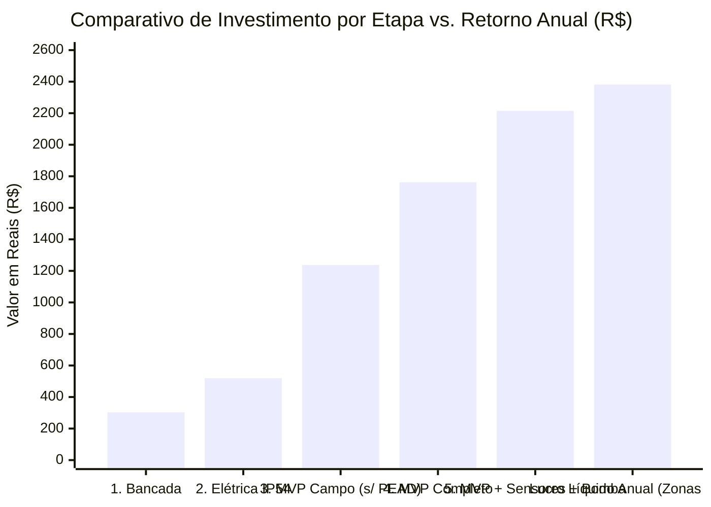

# 06 — Lista de Hardware (BOM), Cenários de Compra e Análise de Custo Financeiro

Este documento consolida toda a **Lista de Materiais (*Bill of Materials* — BOM)** e a análise financeira para a materialização física do sistema **Irriga.ai (Pro-Max)**. Ele decompõe os **4 cenários graduais de compra simulados no Mercado Livre**, lista os componentes sensores/eletrônicos complementares e apresenta o cálculo de **Retorno sobre o Investimento (*Payback*)** com base na produtividade das Zonas A e B.

---

## 1. Decomposição dos 4 Cenários do Orçamento Base (Mercado Livre)

Nas capturas de tela arquivadas em [`legacy/ContextIngested/`](file:///c:/irriga-ai/legacy/ContextIngested), foram estruturados **4 estágios progressivos de aquisição**. A tabela abaixo mostra exatamente o que entra em cada estágio:

| # | Item / Especificação Técnica | Categoria | Preço Unit. (R$) | **Cenário 1: Mínimo Prototipagem** | **Cenário 2: Elétrica Completa** | **Cenário 3: Sem Excessos (2 Zonas)** | **Cenário 4: Completo c/ Cabo e PEAD** |
| :-: | :--- | :--- | :---: | :---: | :---: | :---: | :---: |
| 1 | **ESP32-WROOM-32D 38 Pinos Nova Versão V4 DevKitC** | Controle | $\text{R\$ } 58,96$ | 1 un ($\text{R\$ } 58,96$) | 1 un ($\text{R\$ } 58,96$) | 1 un ($\text{R\$ } 58,96$) | 1 un ($\text{R\$ } 58,96$) |
| 2 | **Módulo Relé 8 Canais 5V 10A c/ Optoacoplador (JD-VCC)** | Acionamento | $\text{R\$ } 34,16$ | 1 un ($\text{R\$ } 34,16$) | 1 un ($\text{R\$ } 34,16$) | 1 un ($\text{R\$ } 34,16$) | 1 un ($\text{R\$ } 34,16$) |
| 3 | **Fonte Chaveada 12V 10A Colmeia Bivolt Metálica (120W)** | Potência | $\text{R\$ } 37,90$ | 1 un ($\text{R\$ } 37,90$) | 1 un ($\text{R\$ } 37,90$) | 1 un ($\text{R\$ } 37,90$) | 1 un ($\text{R\$ } 37,90$) |
| 4 | **10 Peças — Chave Botão PBS-110 Push-Button NA Verde** *(Usa 4 no painel + 6 reserva)* | Interface | $\text{R\$ } 27,54$ | 1 kit ($\text{R\$ } 27,54$) | 1 kit ($\text{R\$ } 27,54$) | 1 kit ($\text{R\$ } 27,54$) | 1 kit ($\text{R\$ } 27,54$) |
| 5 | **Protoboard 830 Pontos Alfanit Breadboard** | Bancada | $\text{R\$ } 18,05$ | 1 un ($\text{R\$ } 18,05$) | 1 un ($\text{R\$ } 18,05$) | 1 un ($\text{R\$ } 18,05$) | 1 un ($\text{R\$ } 18,05$) |
| 6 | **Kit 120 Cabos Jumper Coloridos (M-M, M-F, F-F)** | Bancada | $\text{R\$ } 28,49$ | 1 kit ($\text{R\$ } 28,49$) | 1 kit ($\text{R\$ } 28,49$) | 1 kit ($\text{R\$ } 28,49$) | 1 kit ($\text{R\$ } 28,49$) |
| 7 | **Kit 10 Cabos Garra Jacaré Dupla Coloridos p/ Testes** | Bancada | $\text{R\$ } 18,05$ | 1 kit ($\text{R\$ } 18,05$) | 1 kit ($\text{R\$ } 18,05$) | 1 kit ($\text{R\$ } 18,05$) | 1 kit ($\text{R\$ } 18,05$) |
| 8 | **Ferro de Solda c/ Estanho e Kit de Chave 31 in 1 (220V)** | Ferramenta | $\text{R\$ } 37,04$ | 1 kit ($\text{R\$ } 37,04$) | 1 kit ($\text{R\$ } 37,04$) | 1 kit ($\text{R\$ } 37,04$) | 1 kit ($\text{R\$ } 37,04$) |
| 9 | **Válvula Solenoide 3/4" NF Água Irrigação Irrimax 12V NF** | Hidráulica | $\text{R\$ } 42,90$ | **1 un** ($\text{R\$ } 42,90$) | **1 un** ($\text{R\$ } 42,90$) | **3 un** ($\text{R\$ } 128,70$) | **3 un** ($\text{R\$ } 128,70$) |
| 10 | **Conversor DC-DC Entrada 12V-24V p/ 2 Saídas 5V USB 3A** | Alimentação | $\text{R\$ } 58,00$ | — | 1 un ($\text{R\$ } 58,00$) | 1 un ($\text{R\$ } 58,00$) | 1 un ($\text{R\$ } 58,00$) |
| 11 | **Caixa Comando Hermética Aço Carbono IP54 (40x30x20 cm)** | Painel | $\text{R\$ } 157,89$ | — | 1 un ($\text{R\$ } 157,89$) | 1 un ($\text{R\$ } 157,89$) | 1 un ($\text{R\$ } 157,89$) |
| 12 | **Mangueira Gotejamento Drip Plan 16mm (Rolo 300m, 30x30cm)** | Gotejo | $\text{R\$ } 185,91$ | — | — | 1 rolo ($\text{R\$ } 185,91$) | 1 rolo ($\text{R\$ } 185,91$) |
| 13 | **Kit 50 Registros Iniciais 16mm Rosca + 50 Chulas Vedação** | Gotejo | $\text{R\$ } 249,89$ | — | — | 1 kit ($\text{R\$ } 249,89$) | 1 kit ($\text{R\$ } 249,89$) |
| 14 | **Kit 50 Tampões Final de Linha c/ Rosca Fita Gotejadora 16mm** | Gotejo | $\text{R\$ } 59,90$ | — | — | 1 kit ($\text{R\$ } 59,90$) | 1 kit ($\text{R\$ } 59,90$) |
| 15 | **Broca Manual Perfuradora p/ PVC/PEAD 16mm Irrigação** | Ferramenta | $\text{R\$ } 29,99$ | — | — | 1 un ($\text{R\$ } 29,99$) | 1 un ($\text{R\$ } 29,99$) |
| 16 | **Filtro de Disco Baldr Tipo Y 3/4" (120 Mesh)** | Filtragem | $\text{R\$ } 58,18$ | — | — | 1 un ($\text{R\$ } 58,18$) | 1 un ($\text{R\$ } 58,18$) |
| 17 | **Válvula Ventosa Elimina o Ar do Sistema Rosca 3/4"** | Hidráulica | $\text{R\$ } 33,99$ | — | — | 1 un ($\text{R\$ } 33,99$) | 1 un ($\text{R\$ } 33,99$) |
| 18 | **Rolo de Fio Cabo PP Flexível $2 \times 2,5\text{ mm}^2$ (50 Metros)** | Elétrica | $\text{R\$ } 146,18$ | — | — | — | 1 rolo ($\text{R\$ } 146,18$) |
| 19 | **Mangueira Tubo PEAD 25mm Irrigação Preto 1" (Rolo 200m)** | Tronco | $\text{R\$ } 379,36$ | — | — | — | 1 rolo ($\text{R\$ } 379,36$) |
| — | *Fretes de itens não-Full (Tampões + Filtro)* | Frete | — | Grátis | Grátis | $\text{R\$ } 13,98$ | $\text{R\$ } 13,98$ |
| | **TOTAL LÍQUIDO DE CADA CENÁRIO (c/ Cupom/Pix)** | | | **R$ 303,09** | **R$ 518,98** | **R$ 1.236,62** | **R$ 1.762,16** |

> [!TIP]
> **Dica de Otimização no Item 19 (Tubo PEAD $25\text{ mm}$):**
> No mapa do sítio ([`mapa_2-zonas_irrigacao.png`](file:///c:/irriga-ai/legacy/ContextIngested/mapa_2-zonas_irrigacao.png)), a distância da caixa d'água até o topo norte da Rua Central de $3\text{ m}$ é de aproximadamente **$35\text{ a }45\text{ metros}$** (ou cerca de $70\text{ m}$ se descer uma linha secundária para cada zona). O rolo do Cenário 4 tem **$200\text{ metros}$** (R$ 379,36) — o que é ótimo se você já quiser deixar tubo guardado para levar água até as futuras zonas de **Capim, Laranjas e Palma**, mas caso queira economizar no MVP, um **rolo de $50\text{ m}$ ou $100\text{ m}$ de tubo PEAD $25\text{ mm}$** custa entre **R$ 95,00 e R$ 180,00** (economia imediata de ~R$ 200,00).

---

## 2. Componentes Eletrônicos e Sensores Complementares (Essenciais para o Pro-Max)

Estes componentes constam no manual técnico ([`inicial.md`](file:///c:/irriga-ai/legacy/ContextIngested/inicial.md)) e nos diagramas do projeto, mas ainda não estavam incluídos no carrinho do Mercado Livre:

| Item Complementar | Qtd | Função no Sistema | Preço Unit. Estimado | Subtotal Estimado |
| :--- | :-: | :--- | :---: | :---: |
| **Display OLED 0.96" I2C (SSD1306 – 128x64 px – 4 Pinos)** | 1 | Tela local do painel para o caseiro (`GPIO 21 / 22`). | $\text{R\$ } 22,00$ | **R$ 22,00** |
| **Módulo Buzzer Ativo 3.3V / 5V** | 1 | Alertas sonoros de caixa vazia, falha de vazão e confirmação de botões (`GPIO 2`). | $\text{R\$ } 8,50$ | **R$ 8,50** |
| **Chave de Nível Boia Magnética em Polipropileno (PP)** | 4 | Leitura dos 4 níveis da caixa de $5.000\text{ L}$ ($25\%, 50\%, 75\%, 100\%$) sem corrosão por eletrólise (`GPIO 32, 33, 12, 15`). | $\text{R\$ } 16,00$ | **R$ 64,00** |
| **Sensor de Vazão de Água Efeito Hall 3/4" (YF-S201 / YF-B5, 1–30 L/min)** | 1 | Medição real dos litros aplicados e rotina de *Benchmark* pós-filtro (`GPIO 34`). | $\text{R\$ } 38,00$ | **R$ 38,00** |
| **Kit Diodos `1N4007` (10 un) + Resistores $10\text{ k}\Omega$ (10 un)** | 1 | Proteção *flyback* obrigatória nas bobinas 12V e divisor de tensão $5\text{V}\to 3,3\text{V}$ do sensor Hall. | $\text{R\$ } 6,00$ | **R$ 6,00** |
| **Prensas-Cabo Impermeáveis (Kit 10 un PG9/PG11) + Barra Borne Sindal** | 1 | Passagem vedada dos fios pela Caixa Comando IP54 e organização segura do barramento 12V/220V. | $\text{R\$ } 26,50$ | **R$ 26,50** |
| **Conexões Hidráulicas de Cabeçal (Tês, Joelhos, Adaptadores 3/4" e 1", Fita Veda-Rosca)** | 1 kit | Montagem do cavalete entre a caixa, o filtro, a ventosa, as solenoides `V1`/`V2` e o tubo PEAD $25\text{ mm}$. | $\text{R\$ } 65,00$ | **R$ 65,00** |
| **SUBTOTAL — COMPLEMENTOS ESSENCIAIS DO MVP** | | | | **R$ 230,00** |

---

## 3. Custos dos Módulos de Pressurização e Expansões Futuras (Fase 2)

### 3.1. Módulo de Pressurização (Escolha entre Opção A ou Opção B conforme Caderno 02)

| Opção | Componentes Adicionais Necessários | Custo Estimado | Quando Escolher |
| :--- | :--- | :---: | :--- |
| **Opção A — Pressurização Ativa 12V** | • 1x **Bomba Diafragma 12V Alta Vazão** ($\text{R\$ } 150,00$) • 1x **Regulador de Pressão 3/4" 15 PSI / 1,0 bar** ($\text{R\$ } 38,00$) • 1x **Válvula de Retenção Portinhola 3/4"** ($\text{R\$ } 35,00$) | **+ R$ 223,00** | Se a caixa de $5.000\text{ L}$ permanecer a apenas $0,5\text{ m}$ do chão e você usar as solenoides *Irrimax 3/4" NF* do carrinho. |
| **Opção B1 — Gravidade com Caixa a $\ge 2,5\text{ m}$** | • Nenhum componente elétrico extra (usa as solenoides *Irrimax* do carrinho direto por gravidade). | **+ R$ 0,00** *(apenas base elevada)* | Se a caixa já tiver (ou ganhar) desnível $\ge 2,5\text{ m}$ até a área de plantio. |
| **Opção B2 — Gravidade a $0,5\text{ m}$ c/ Válvulas de Esfera Motorizadas 12V** | • Substituir as 3 solenoides pilotadas ($\text{R\$ } 128,70$) por **2 ou 3 Válvulas de Esfera Motorizadas 12V 3/4" Passagem Plena** ($\approx\text{R\$ } 115,00$ cada). | **+ R$ 102,00 a R$ 216,00** *(diferença)* | Se a caixa ficar a $0,5\text{ m}$ e você quiser operar 100% por gravidade sem bomba. |

### 3.2. Expansões de Fase 2 (Previstas no Diagrama `Irriga.ai-alpha.png`)

| Módulo de Expansão (Fase 2) | Componentes Previstos | Custo Estimado (Ref. Diagrama Alpha) |
| :--- | :--- | :---: |
| **Módulo Solar Off-Grid 12V** | 1x Painel Solar Fotovoltaico + 1x Controlador de Carga Solar PWM/MPPT (c/ saídas 12V e 5V USB) + Banco de Bateria Estacionária 12V. | **R$ 626,00** |
| **Expansão para Zonas C, D e E (Capim, Laranjas e Palma)** | 3x Válvulas Solenoides 3/4" 12V NF ($3 \times \text{R\$ } 42,90 = \text{R\$ } 128,70$) + Mangueira de gotejo/microaspersão adicional *(os 3 canais de relé já estão prontos e pagos na placa R1 do MVP!)*. | **R$ 128,70** *(+ mangueiras da área nova)* |
| **Painel de Purga / Retrolavagem Automática de Filtros** | 1x Segundo Filtro de Alta Vazão ($\text{R\$ } 58\text{ a R\$ } 300$) + 1x Segundo Módulo Relé 8 Canais ($\text{R\$ } 34,16$) + 6 a 8 Válvulas Solenoides 12V dedicadas à manobra reversa ($6 \times \text{R\$ } 42,90 = \text{R\$ } 257,40$). | **R$ 350,00 a R$ 590,00** |

---

## 4. Resumo Financeiro Consolidado e Análise de *Payback* (ROI)

### Quadro Resumo de Desembolso Total:
1. **Para começar a programar e testar em bancada hoje (Cenário 1 + OLED + Buzzer):** **$\approx \text{R\$ } 333,59$**
2. **Sistema MVP Completo Instalado em Campo (Cenário 4 + Sensores/Boias/OLED + Opção Gravidade):** **$\approx \text{R\$ } 1.992,16$**
3. **Sistema MVP Completo Instalado em Campo Pressurizado (Cenário 4 + Sensores/Boias/OLED + Bomba 12V e Regulador):** **$\approx \text{R\$ } 2.215,16$**
4. **Custo Mensal de Software / Nuvem / Previsão do Tempo:** **$\text{R\$ } 0,00/\text{mês}$** (Vercel + Supabase Free Tier + Open-Meteo + Telegram Bot).

### Cálculo de *Payback* Agronômico (Zonas A + B = $286\text{ m}^2$):
Conforme demonstrado no [Caderno 04 (Seção 2)](file:///c:/irriga-ai/pro-max/04_agronomia_culturas_e_algoritmo_clima.md), a rotação planejada nas **Zonas A ($128\text{ m}^2$)** e **B ($158\text{ m}^2$)** utilizando os números conservadores do `guia_culturas_gotejamento.pdf` gera:
* **Zona A ($128\text{ m}^2$ — Maxixe $\to$ Feijão Verde $\to$ Batata-doce):** $\text{R\$ } 560 + \text{R\$ } 179 + \text{R\$ } 362 = \mathbf{\text{R\$ } 1.101,00/\text{ano}}$ de margem de caixa.
* **Zona B ($158\text{ m}^2$ — Batata-doce $\to$ Melancia $\to$ Feijão Verde):** $\text{R\$ } 447 + \text{R\$ } 613 + \text{R\$ } 221 = \mathbf{\text{R\$ } 1.281,00/\text{ano}}$ de margem de caixa.
* **Margem de Caixa Total Anual ($286\text{ m}^2$):** **$\mathbf{\text{R\$ } 2.382,00/\text{ano}}$** ($\approx \text{R\$ } 198,50/\text{mês}$).
* **Tempo de Retorno do Investimento (*Payback*):** Entre **10 e 11 meses** (menos de 1 ano agrícola completo), além da economia diária de mão de obra do caseiro e da redução de até $35\%$ no consumo de água da caixa de $5.000\text{ L}$.
