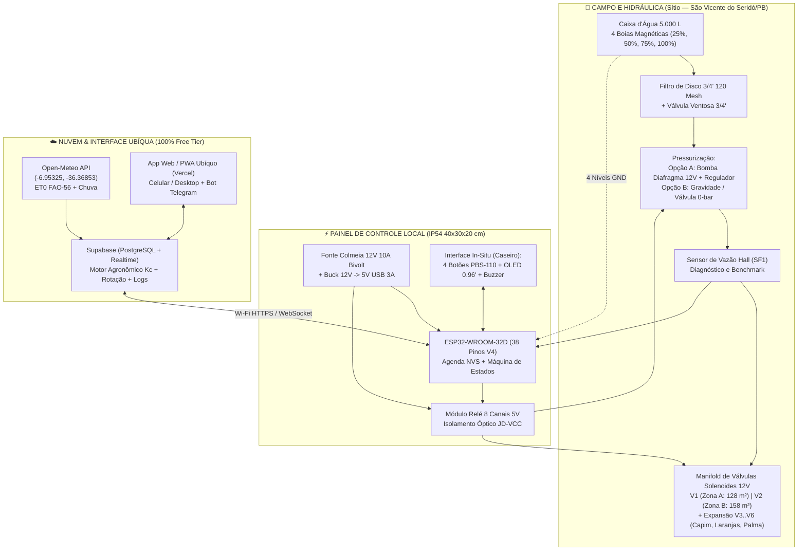

# 🌱 Irriga.ai (Pro-Max) — Documentação Oficial de Arquitetura e Engenharia

Bem-vindo à documentação central do **Irriga.ai (Pro-Max)**, o sistema inteligente de irrigação automatizada, gestão hídrica e suporte à decisão agronômica projetado para operação resiliente no semiárido brasileiro.

Todos os rascunhos, diagramas preliminares, capturas de tela de orçamentos e guias agronômicos originais foram lidos, consolidados, verificados tecnicamente e arquivados em [`legacy/ContextIngested/`](file:///c:/irriga-ai/legacy/ContextIngested).

---

## 📍 Contexto Geográfico e Operacional do Projeto

| Parâmetro | Especificação Oficial |
| :--- | :--- |
| **Localização do Sítio** | Próximo a **São Vicente do Seridó – PB** (Mesorregião da Borborema / Seridó Paraibano) |
| **Coordenadas Geográficas** | `6°57'11.7"S, 36°22'06.7"W` (Decimal: `lat = -6.95325`, `lon = -36.36853`) |
| **Clima Regional** | Semiárido quente (BSh), alta insolação, baixa umidade relativa e elevada evapotranspiração de referência ($ET_0$ típica de $4,5\text{ a }6,5\text{ mm/dia}$) |
| **Reservatório Principal** | Caixa d'água de **5.000 Litros**, posicionada a $\approx 0,5\text{ m}$ acima do nível médio do terreno |
| **Cota Diária de Água** | **Configurável dinamicamente** (ex.: $1.000\text{ L/dia}$ na estação seca, ajustável conforme recarga/época) |
| **Área Produtiva Inicial (MVP)** | **286 m² úteis** divididos em **Zona A (Oeste: 128 m²)** e **Zona B (Leste: 158 m²)**, separados por rua central de $3\text{ m}$ ($\approx 64\text{ m}^2$) com palmeira preservada |
| **Expansão Prevista (Fase 2)** | Até **6 a 8 zonas** (incluindo áreas de **Capim**, **Laranjas** e **Palma Forrageira**) + **Painel de Retrolavagem Automática de Filtros** |
| **Microcontrolador Base** | **ESP32-WROOM-32D (DevKitC V4 – 38 Pinos)** com conectividade Wi-Fi 2.4 GHz |
| **Alimentação Elétrica** | **MVP:** Rede elétrica 220V AC $\to$ Fonte Chaveada 12V 10A + Conversor Buck 12V $\to$ 5V USB 3A. **Fase 2:** Kit Solar Off-Grid 12V (Painel + Controlador de Carga + Bateria) |

---

## 🗂️ Estrutura da Documentação (`pro-max/`)

A documentação foi dividida em **6 cadernos técnicos modulares** para facilitar a execução física (hidráulica e elétrica), a compra de materiais e o desenvolvimento de software (firmware e plataforma web):

1. 📄 **[01 — Funcionalidades, Operação e Regras de Negócio](file:///c:/irriga-ai/pro-max/01_funcionalidades_e_regras_negocio.md)**
   * Requisitos funcionais do MVP e das fases futuras.
   * Interface física "in-situ" (4 botões de override para o caseiro + Display OLED + Buzzer).
   * Modo **Offline / Off-Grid resiliente** (memória de rotina dos últimos 7 dias e agenda local persistente).
   * Algoritmo de **Gestão de Cota Hídrica Configurável** e **Rotina de Benchmark de Vazão** (detecção de entupimento de filtro, vazamentos e cavitação).
   * Máquina de Estados (FSM) e **Intertravamentos de Segurança (`Safety Interlocks`)**.

2. 💧 **[02 — Sistema Hidráulico, Layout de Zonas e Pressurização](file:///c:/irriga-ai/pro-max/02_sistema_hidraulico_e_zonas.md)**
   * Planta baixa e topologia hidráulica das Zonas A ($128\text{ m}^2$) e B ($158\text{ m}^2$) com tubulação tronco PEAD $25\text{ mm}$ ($1"$) e $285\text{ m}$ de fita gotejadora $16\text{ mm}$.
   * **Estudo Comparativo das 2 Opções de Pressurização**:
     * *Opção A:* Bomba Auxiliar de Diafragma 12V + Regulador de Pressão + Pressostato (compatível com solenoides pilotadas Irrimax de $\ge 0,02\text{ MPa}$).
     * *Opção B:* Gravidade Pura (elevação da caixa para $\ge 2,5\text{ m}$ ou uso de válvulas solenoides zero-pressão / válvulas motorizadas de esfera 12V).
   * Arquitetura da Fase 2: **Painel de Purga / Retrolavagem Automática** (2 filtros em paralelo + 8 válvulas nos modos Nominal `N`, Purga 1 e Purga 2).

3. ⚡ **[03 — Sistema Elétrico, Pinout do ESP32 e Segurança de Hardware](file:///c:/irriga-ai/pro-max/03_sistema_eletrico_e_pinout_esp32.md)**
   * Especificação e pinout oficial do **ESP32-WROOM-32D 38 Pinos V4 DevKitC** (eliminando conflitos de pinos de *boot* e corrigindo divergências com o antigo rascunho S3).
   * Mapa completo de ligações: Relés (8 canais), 4 Botões (`INPUT_PULLUP`), 4 Boias Magnéticas de Nível (`INPUT_PULLUP`), Sensores de Vazão Hall (`SF1`/`SF2`), Display OLED I2C e Buzzer Ativo.
   * **Regras de Ouro de Blindagem Eletromagnética (EMI)**: Isolamento óptico via `JD-VCC`, diodos *flyback* (`1N4007`) nas solenoides 12V, proteção contra curto-circuito por configuração indevida de GPIO e dimensionamento do cabo PP $2 \times 2,5\text{ mm}^2$.

4. 🌾 **[04 — Agronomia, Guia de Culturas, Fenologia ($K_c$) e Clima](file:///c:/irriga-ai/pro-max/04_agronomia_culturas_e_algoritmo_clima.md)**
   * Consolidação completa do **Guia de Culturas para Gotejamento** (Maxixe, Melancia, Batata-doce, Feijão verde, Jerimum, Milho verde, Macaxeira, Mandioca e Batatinha): consumo hídrico, fases críticas, espaçamento, custos e rentabilidade por $\text{m}^2/\text{dia}$.
   * Plano de rotação de culturas das Zonas A e B com defasagem estratégica.
   * **Motor Fenológico Dinâmico ($K_c$ por estágio da planta)**: ajuste automático da lâmina de água conforme os Dias Após o Plantio (DAP) — incluindo o **corte gradual de água na Melancia nos últimos 7–10 dias pré-colheita** para concentração de açúcar (°Brix).
   * Integração meteorológica com a API **Open-Meteo** para as coordenadas `-6.95325, -36.36853` ($ET_0$ FAO-56, precipitação prevista e balanço hídrico).

5. 💻 **[05 — Arquitetura de Software, Firmware ESP32 e Interface Online Ubíqua](file:///c:/irriga-ai/pro-max/05_arquitetura_software_e_interface_online.md)**
   * Arquitetura **Cloud Custo Zero (R$ 0/mês)**: Web App Progressivo (**PWA** em Next.js/React na Vercel/Cloudflare) + **Supabase Free Tier** (PostgreSQL, Auth, Realtime, Edge Functions) + **Open-Meteo API** + **Telegram Bot** para alertas críticos.
   * Estratégia técnica *anti-pausa* para manter o banco gratuito do Supabase sempre ativo através do próprio *heartbeat* do ESP32, além do comparativo entre plano gratuito e pago.
   * Telas da interface ubíqua, modelo de banco de dados (SQL), protocolo de sincronização JSON e arquitetura multitarefa (FreeRTOS) do firmware no ESP32.

6. 💰 **[06 — Lista de Hardware (BOM), Cenários de Compra e Análise Financeira](file:///c:/irriga-ai/pro-max/06_lista_hardware_e_custos_bom.md)**
   * Decomposição exata dos **4 cenários de carrinho do Mercado Livre** (de **R$ 303,09** na prototipagem mínima até **R$ 1.762,16** na montagem completa com cabo PP 50m e tubo PEAD 200m).
   * Lista de componentes complementares (OLED, boias magnéticas, sensores de fluxo Hall, reguladores de pressão, bomba 12V e kit solar).
   * Estudo de **Viabilidade Econômica e Payback (ROI)** cruzando o investimento de hardware com o lucro líquido projetado das safras nas Zonas A e B.

---

## 🏗️ Visão Geral da Arquitetura do Sistema

---

## 🚀 Próximos Passos Recomendados para Implementação

1. **Fase 0 — Bancada (Semana 1):** Montar o circuito em protoboard seguindo o [Caderno 03 (Elétrica e Pinout)](file:///c:/irriga-ai/pro-max/03_sistema_eletrico_e_pinout_esp32.md), validando o acionamento isolado (`JD-VCC`) do módulo de 8 relés, leitura dos 4 botões PBS-110, simulação dos 4 níveis da caixa e exibição no display OLED.
2. **Fase 1 — Hidráulica MVP 2 Zonas (Semana 2):** Instalar a linha principal PEAD $25\text{ mm}$, filtro de disco, ventosa, solenoides `V1`/`V2` e as linhas de gotejamento nas Zonas A e B conforme o [Caderno 02 (Hidráulica)](file:///c:/irriga-ai/pro-max/02_sistema_hidraulico_e_zonas.md), definindo em bancada se a pressão local operará com a Opção A (Bomba 12V) ou Opção B (Gravidade/Elevação).
3. **Fase 2 — Firmware Base e Modo Offline (Semana 3):** Gravar o firmware inicial no ESP32-WROOM-32D com os intertravamentos de segurança, botões de override, memória offline de 7 dias e rotina de benchmark de vazão descritos no [Caderno 01](file:///c:/irriga-ai/pro-max/01_funcionalidades_e_regras_negocio.md).
4. **Fase 3 — Nuvem, Clima e Fenologia (Semana 4):** Subir o banco no Supabase e a interface PWA conforme os [Cadernos 04](file:///c:/irriga-ai/pro-max/04_agronomia_culturas_e_algoritmo_clima.md) e [05](file:///c:/irriga-ai/pro-max/05_arquitetura_software_e_interface_online.md), ativando o ajuste automático por estágio fenológico ($K_c$) e previsão do tempo para São Vicente do Seridó – PB.
